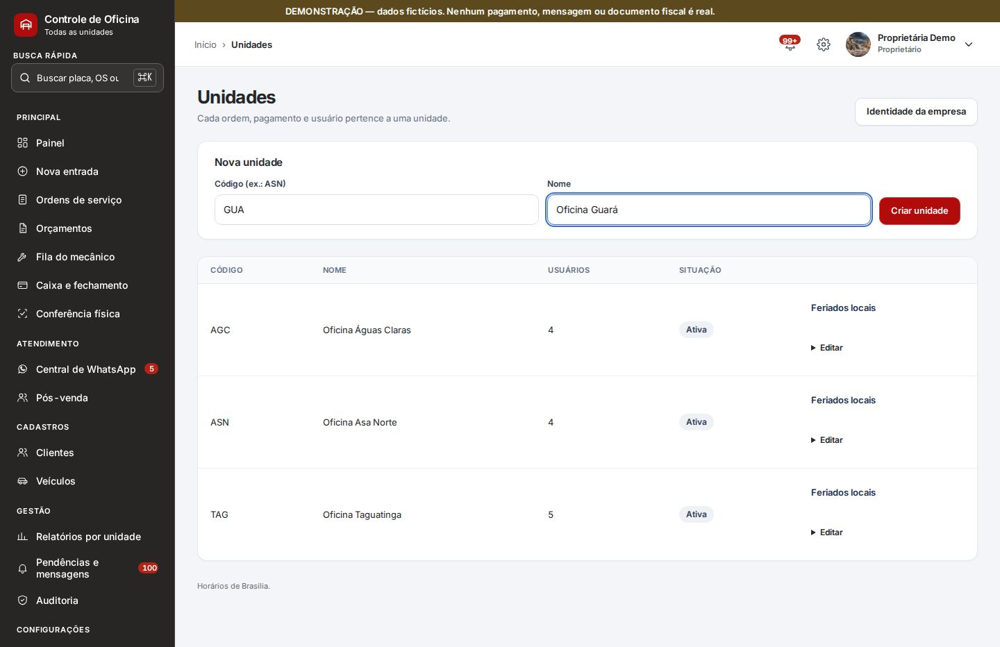
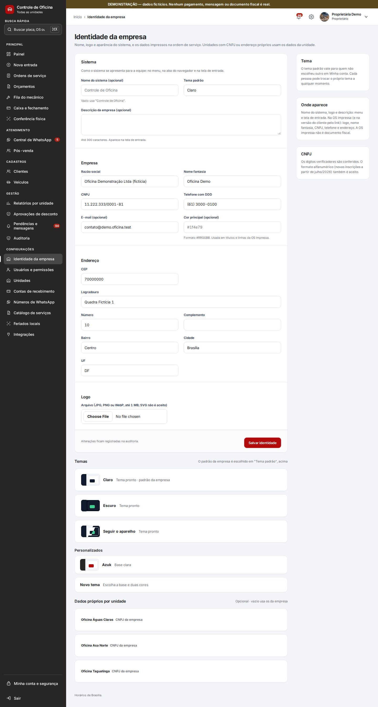
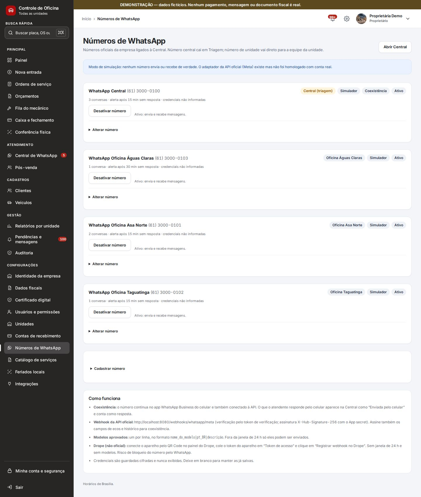
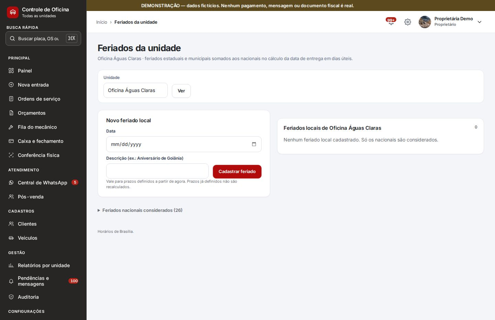
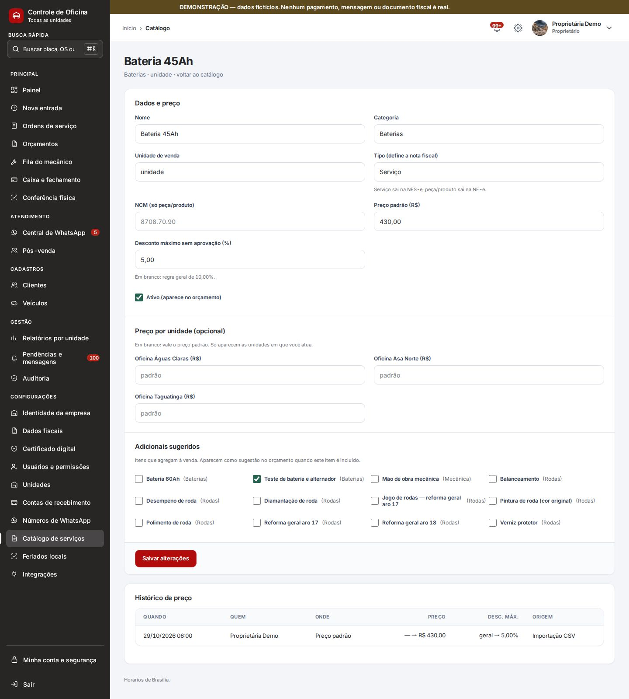
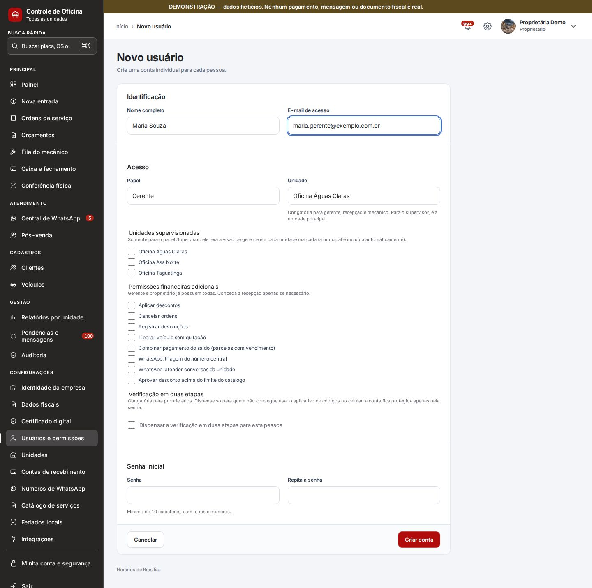
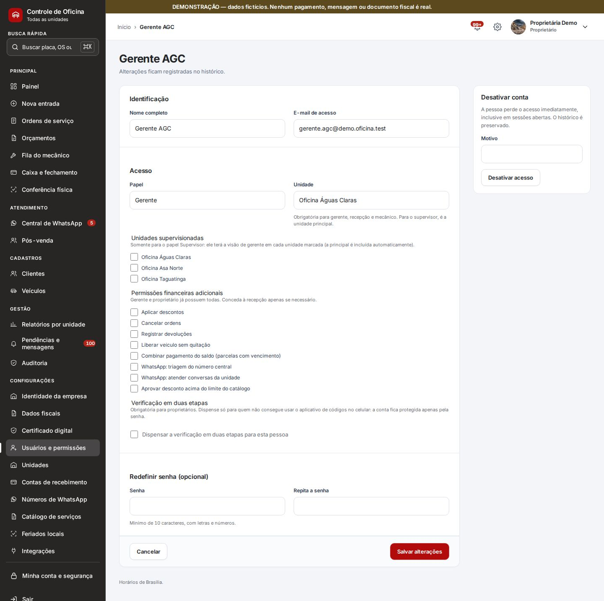

# Manual do proprietário — abrir uma unidade nova e preparar a gerente

Passo a passo para o **dono** colocar uma **oficina nova** no sistema, cadastrar a **gerente** e a equipe, e **treinar a gerente** nas primeiras semanas.

> **Sobre as fotos.** As imagens são da **versão de demonstração**, com dados fictícios (por isso aparece a faixa marrom "DEMONSTRAÇÃO"). Nos exemplos, a unidade nova é a **"Oficina Guará"** (código **GUA**) e a gerente é a **"Maria Souza"**. Telas capturadas em 12/11/2026. O uso do dia a dia está no [Manual de uso](./).

---

## Sumário

1. [Antes de começar](#1-antes-de-começar)
2. [Criar a unidade](#2-criar-a-unidade)
3. [Dados da unidade na OS impressa](#3-dados-da-unidade-na-os-impressa)
4. [WhatsApp da unidade](#4-whatsapp-da-unidade)
5. [Feriados, preços e conta de recebimento](#5-feriados-preços-e-conta-de-recebimento)
6. [Cadastrar a gerente](#6-cadastrar-a-gerente)
7. [Cadastrar o resto da equipe](#7-cadastrar-o-resto-da-equipe)
8. [Conferir se ficou tudo certo](#8-conferir-se-ficou-tudo-certo)
9. [Treinar a gerente](#9-treinar-a-gerente)
10. [Dúvidas frequentes](#10-dúvidas-frequentes)

---

## 1. Antes de começar

**Só o dono faz estas configurações.** A gerente não cria unidade, usuário nem número de WhatsApp. O sistema pede a **sua senha de novo** antes de abrir as telas de configuração (é uma proteção a mais).

Tenha em mãos:

| O quê | Para quê | Obrigatório? |
|---|---|---|
| **Nome** da oficina e um **código curto** (ex.: GUA) | Criar a unidade e numerar as OS | Sim |
| **Telefone** e **endereço** da oficina | Sair na OS impressa | Recomendado |
| **CNPJ próprio**, se a oficina tiver | Sair na OS impressa | Só se for diferente do da empresa |
| **Celular com o WhatsApp da oficina** e acesso ao painel do **Drope** | Atender clientes pela Central | Se a unidade tiver WhatsApp próprio |
| **Nome completo** e **e-mail** de cada pessoa da equipe | Criar as contas | Sim |

**Ordem recomendada:** unidade → dados da unidade → WhatsApp → feriados e preços → gerente → equipe → conferência. Dá para fazer tudo em mais ou menos 30 minutos.

## 2. Criar a unidade

Menu **Unidades** (em Configurações).

1. Em **Código (ex.: ASN)**, digite um código curto, **só com letras e números** (até 10). Ex.: **GUA**.
2. Em **Nome**, o nome que a equipe vai ver. Ex.: **Oficina Guará**.
3. Clique em **Criar unidade**. Aparece *"Unidade Oficina Guará criada."*

**Escolha bem o código.** Ele é o começo do número de **todas as OS** da unidade: a primeira será **GUA-00001**, depois GUA-00002 e assim por diante. Cada unidade tem a **sua própria numeração**. Evite mudar o código depois de abrir OS: as antigas continuam com o código antigo e a numeração fica confusa.

A unidade já nasce **ativa**. Para fechar uma unidade no futuro, use **Editar** e desmarque **Unidade ativa**. Nada é apagado.

## 3. Dados da unidade na OS impressa

Menu **Identidade da empresa**, parte **Dados próprios por unidade** (no fim da página).

1. Clique no nome da unidade nova para abrir.
2. Preencha **CNPJ da unidade** (só se for diferente do da empresa), **Telefone da unidade** e o **endereço**.
3. Clique em **Salvar dados da unidade**.

Em branco, a OS impressa usa os dados da empresa.

> **Nota fiscal.** As notas fiscais saem **sempre com o CNPJ e o certificado digital da empresa**, para todas as unidades, com a numeração única da empresa. Se a unidade nova tiver **CNPJ próprio** e precisar **emitir as notas dela**, isso ainda **não existe** no sistema: fale com o suporte antes de abrir a unidade.

## 4. WhatsApp da unidade

Menu **Números de WhatsApp**. Duas escolhas:

- **Sem número próprio:** os clientes da unidade nova escrevem para o **número central**. Quem faz a **triagem** passa a conversa para a unidade. Não precisa fazer nada aqui.
- **Com número próprio:** as conversas vão **direto** para a equipe da unidade. Siga os passos abaixo.

1. No painel do **Drope**, conecte o celular da oficina lendo o **QR Code** e copie o **token do aparelho**.
2. Aqui, clique em **Cadastrar número** e preencha:
   - **Descrição:** ex. *WhatsApp Guará*;
   - **Telefone (DDD + número)** do celular da oficina;
   - **Pertence a:** a unidade nova (**Oficina Guará**);
   - **Alerta sem resposta após (minutos):** em quanto tempo o sistema avisa que um cliente está esperando (15 é um bom começo);
   - **Integração:** **Drope (QR Code, não oficial)**;
   - **Token de acesso:** cole o token do Drope.
3. Clique em **Cadastrar número**.
4. No cartão do número novo, clique em **Registrar webhook no Drope**. Sem isso, as mensagens dos clientes **não chegam** na Central.
5. **Teste:** de outro celular, mande uma mensagem para o número da oficina. Ela deve aparecer na **Central de WhatsApp**, na unidade nova, em poucos segundos. Responda pela Central e veja se chega.

Cuidados:

- Este número também passa a enviar as **mensagens automáticas** das OS da unidade (por exemplo, "OS enviada por WhatsApp").
- Se o número for **desativado**, essas mensagens falham. Depois de reativar, reenvie em **Pendências e mensagens**.
- **Não dá para trocar o telefone** de um número que já tem conversas. Cadastre um número novo e desative o antigo.
- O Drope é **não oficial**: o WhatsApp pode bloquear o número. Não use para mensagens em massa.

## 5. Feriados, preços e conta de recebimento

**Feriados locais.** Na tela **Unidades**, clique em **Feriados locais** na linha da unidade nova e cadastre os feriados da cidade. O sistema usa esses dias para calcular os prazos de entrega. O passo a passo está em [9.1 do Manual de uso](./#91-feriados-locais).

**Preços da unidade (opcional).** O **Catálogo de serviços** é um só para todas as unidades. Se a unidade nova cobra **outro preço** em algum serviço, abra o item no catálogo e preencha o **Preço por unidade**. Em branco, vale o preço padrão. Veja [8.11 do Manual de uso](./#811-catálogo-de-serviços).

**Conta de recebimento.** Menu **Contas de recebimento**. É a conta para onde iriam as **cobranças Pix automáticas** da unidade. Hoje o Pix automático **ainda não está contratado**, então este passo pode ficar para depois. Os Pix feitos no app do banco são registrados à mão na OS, como nas outras unidades.

## 6. Cadastrar a gerente

Menu **Usuários e permissões** › **Novo usuário**.

1. **Nome completo** e **E-mail de acesso** da gerente. O e-mail é o login dela; use um e-mail que ela use de verdade.
2. **Papel:** **Gerente**.
3. **Unidade:** a unidade nova (**Oficina Guará**).
4. **Unidades supervisionadas:** deixe em branco (é só para o papel Supervisor).
5. **Permissões financeiras adicionais:** não precisa marcar nada. A gerente **já tem** descontos, cancelamento, devoluções, liberar veículo sem quitação e combinar pagamento.
6. **Verificação em duas etapas:** não se aplica a ela. Só é obrigatória para proprietários.
7. **Senha inicial:** pelo menos 10 caracteres, com letras e números. Repita em **Repita a senha**.
8. Clique em **Criar conta**.

**Entregue o acesso pessoalmente** (ou por ligação): o endereço **oficina.controleoficina.com.br**, o e-mail e a senha inicial. Não mande a senha em grupo de WhatsApp. No primeiro acesso, peça para ela trocar a senha em **Minha conta e segurança** › **Alterar senha**.

**O que a gerente faz no sistema:** registra entradas, monta e aprova orçamentos, dá desconto, recebe e combina pagamentos, entrega o carro, fecha o caixa, atende o WhatsApp da unidade, faz o pós-venda, cuida do catálogo, resolve pendências e vê a auditoria e os indicadores **da unidade dela**.

**O que ela não faz:** ver outras unidades; criar usuários ou unidades; mexer em números de WhatsApp, contas de recebimento, dados fiscais ou certificado digital; cadastrar feriados; fazer a **triagem** do número central.

**Gerente que cuida de mais de uma unidade:** use o papel **Supervisor** e marque as unidades em **Unidades supervisionadas**. O supervisor tem tudo o que o gerente tem em cada unidade marcada e também cadastra feriados.

## 7. Cadastrar o resto da equipe

Repita o **Novo usuário** para cada pessoa, sempre com **Unidade: Oficina Guará**. **Uma conta por pessoa**: nunca compartilhe login, porque o histórico registra quem fez cada coisa.

| Papel | Para quem | O que faz |
|---|---|---|
| **Recepção/caixa** | Balcão e caixa | Entrada do carro, cobrança, entrega, conferência, WhatsApp e pós-venda. **Não monta orçamento.** |
| **Mecânico** | Oficina | Fila, diagnóstico e execução. **Nunca vê valores nem o contato do cliente.** |

**Permissões a mais para a recepção** (só se precisar): marque em **Permissões financeiras adicionais**. Ex.: **WhatsApp: triagem do número central**, para quem vai distribuir as conversas do número central entre as unidades.

## 8. Conferir se ficou tudo certo

Faça com a gerente do lado, no computador da oficina:

- [ ] Ela entra com o e-mail e a senha dela e troca a senha.
- [ ] O **Painel** mostra a **Oficina Guará** e nenhuma outra unidade.
- [ ] Em **Nova entrada**, a unidade é a **Oficina Guará**.
- [ ] Na **Central de WhatsApp**, a mensagem de teste do passo 4 aparece para ela.
- [ ] Em **Usuários e permissões**, filtrando pela unidade nova, aparecem todas as contas da equipe.
- [ ] A **OS impressa** da primeira OS mostra o telefone e o endereço certos.

**Não crie OS de teste no sistema real.** Cada OS gasta um número da sequência (GUA-00001, GUA-00002…), e OS não se apagam: só se cancelam. Use o **primeiro carro de verdade** como treino, com você ao lado.

## 9. Treinar a gerente

Um roteiro em **quatro conversas** de mais ou menos 1 hora, com o sistema aberto. Em cada uma: você mostra, ela faz e depois explica de volta com as palavras dela. O detalhe de cada tela está no [Manual de uso](./).

### 9.1 Primeiro dia: entrar e receber o carro

- Como entrar, sair e trocar a senha ([4](./#4-como-entrar-no-sistema) e [10.12](./#1012-minha-conta-todos-os-papéis)).
- O caminho de uma OS, da chegada à entrega ([2](./#2-o-caminho-de-uma-ordem-de-serviço)).
- O painel dela e o que cada número significa ([8.1](./#81-painel-do-gerente)).
- **Fazer junto:** registrar a entrada do primeiro carro real ([6.2](./#62-registrar-a-entrada-de-um-veículo)): buscar o cliente pelo nome, placa, **Buscar dados do veículo**, motivo com as palavras do cliente e fotos.

**Ela está pronta quando:** registra uma entrada sozinha, sem duplicar o cliente.

### 9.2 Orçamento e aprovação

- Montar o orçamento a partir do catálogo, serviço × peça e desconto ([8.2](./#82-montar-e-aprovar-um-orçamento) e [8.3](./#83-desconto-sem-aprovação)).
- Combinar com o cliente e **aprovar na oficina** ([6.4](./#64-aprovar-o-orçamento-na-oficina)).
- Prazo de entrega, mecânico responsável e vendedor ([8.4](./#84-prazo-de-entrega-mecânico-e-vendedor)).
- **Orçamento sem o carro**, para quem só quer saber o preço ([8.14](./#814-orçamento-sem-entrada-do-veículo)).

**Ela está pronta quando:** monta, envia e aprova um orçamento e sabe explicar a diferença entre **aprovado** e **recebido**.

### 9.3 Dinheiro: receber, entregar e fechar o caixa

- Receber à vista, em parte ou combinar parcelas; Pix no app do banco com comprovante ([6.5](./#65-receber-o-pagamento) e [8.5](./#85-receber-combinar-parcelas-e-liberar-sem-pagamento)).
- Entregar o carro e quando liberar sem pagamento (sempre com motivo) ([6.6](./#66-entregar-o-veículo)).
- **Emitir as notas fiscais** e usar a **Observação na nota** ([11.5](./#115-aba-documentos-e-mensagens)).
- Fechar o caixa no fim do dia ([8.6](./#86-caixa-e-fechamento)).

**Ela está pronta quando:** fecha um caixa sem diferença e sabe o que fazer quando o dinheiro não bate.

### 9.4 Acompanhar a unidade

- **Central de WhatsApp:** responder, ligar a conversa ao cliente e à OS, encerrar com motivo ([6.11](./#611-central-de-whatsapp)).
- **Pendências e mensagens:** o que cada pendência significa, como resolver, **Resolver todas** e o sino ([8.8](./#88-pendências-e-mensagens)).
- Conferência física do pátio e divergências ([6.8](./#68-conferência-física-do-pátio) e [8.9](./#89-divergências-da-conferência)).
- Pós-venda ([6.12](./#612-pós-venda)), indicadores ([8.10](./#810-indicadores-da-loja)) e planilha Excel ([8.13](./#813-planilha-excel)).
- OS do sistema antigo, se o cliente tiver alguma em aberto ([6.14](./#614-os-do-sistema-antigo)).

**Ela está pronta quando:** abre o painel de manhã e diz sozinha o que precisa ser feito no dia.

### 9.5 Nas primeiras semanas

- **Primeira semana:** olhe com ela, todo fim de dia, o **Painel**, as **Pendências** e o **fechamento do caixa**.
- **Da segunda semana em diante:** acompanhe de longe pelo seu **Painel central** ([10.3](./#103-painel-central-indicadores-de-todas-as-unidades)) e pela **Auditoria** ([8.12](./#812-auditoria-histórico-de-ações)).
- Deixe com ela o link do manual: **controleoficina.com.br/manual**.

## 10. Dúvidas frequentes

**Errei o código da unidade. E agora?**
Se ainda não abriu nenhuma OS, corrija em **Unidades** › **Editar**. Se já abriu, deixe como está ou fale com o suporte.

**A gerente esqueceu a senha.**
Abra o usuário dela em **Usuários e permissões**, preencha **Redefinir senha** e salve. Entregue a senha nova pessoalmente e peça para ela trocar no primeiro acesso.

**A gerente saiu da empresa.**
No usuário dela, use **Desativar conta** e escreva o motivo. Ela perde o acesso **na hora**, inclusive em computadores onde estava aberta. Todo o histórico dela é preservado.

**A gerente vai cuidar de duas oficinas.**
Mude o papel dela para **Supervisor** e marque as duas em **Unidades supervisionadas** (veja [6](#6-cadastrar-a-gerente)).

**Posso usar o número central em vez de um número próprio?**
Pode. As conversas caem na **Triagem**, e alguém com a permissão **WhatsApp: triagem do número central** passa cada uma para a unidade certa.

**A unidade vai fechar.**
Em **Unidades** › **Editar**, desmarque **Unidade ativa** e desative as contas da equipe e o número de WhatsApp dela. Nada é apagado: as OS e o histórico continuam disponíveis para consulta.
