# Manual de uso — Controle de Oficina

Guia completo, com fotos das telas, para quem usa o sistema no dia a dia: dono, gerente, supervisor, recepção/caixa e mecânico. No fim, há uma parte sobre o que o cliente vê pelo link.

> **Sobre as fotos.** Todas as imagens foram tiradas da **versão de demonstração**, com dados fictícios (clientes, placas, valores e telefones inventados). Por isso aparece a faixa marrom **"DEMONSTRAÇÃO — dados fictícios"** no alto da tela. No sistema real essa faixa não aparece. As telas foram capturadas em 05/11/2026; os dados da demonstração vão de 30/09 a 29/10/2026.

---

## Sumário

1. [O que é o sistema](#1-o-que-é-o-sistema)
2. [O caminho de uma ordem de serviço](#2-o-caminho-de-uma-ordem-de-serviço)
3. [Quem pode fazer o quê](#3-quem-pode-fazer-o-quê)
4. [Como entrar no sistema](#4-como-entrar-no-sistema)
5. [Conhecendo a tela](#5-conhecendo-a-tela)
6. [Recepção e caixa](#6-recepção-e-caixa)
7. [Mecânico](#7-mecânico)
8. [Gerente](#8-gerente)
9. [Supervisor](#9-supervisor)
10. [Dono (proprietário)](#10-dono-proprietário)
11. [A ordem de serviço por dentro (todas as abas)](#11-a-ordem-de-serviço-por-dentro-todas-as-abas)
12. [Um atendimento do começo ao fim](#12-um-atendimento-do-começo-ao-fim)
13. [O que o cliente vê pelo link](#13-o-que-o-cliente-vê-pelo-link)
14. [Mensagens de erro e telas de aviso](#14-mensagens-de-erro-e-telas-de-aviso)
15. [O que ainda não é real](#15-o-que-ainda-não-é-real)
16. [Dúvidas frequentes](#16-dúvidas-frequentes)
17. [Glossário](#17-glossário)

---

## 1. O que é o sistema

O Controle de Oficina registra tudo o que acontece com cada veículo, da chegada até a entrega:

- **quem recebeu** o carro e o que o cliente contou;
- **o que o mecânico encontrou** (diagnóstico e fotos);
- **o orçamento** e a **aprovação do cliente**;
- **os serviços feitos**;
- **o pagamento** (Pix, dinheiro ou cartão) e a **entrega**.

Cada ação fica guardada com o nome de quem fez e o horário. Isso vale para as três oficinas da rede (Asa Norte, Taguatinga e Águas Claras, na demonstração). Cada pessoa tem a própria conta e vê apenas as unidades em que trabalha.

Três ideias guiam o sistema:

- **Orçado, aprovado e recebido são coisas diferentes.** Um orçamento enviado não é dinheiro. Um orçamento aprovado também não. Só conta como recebido o que entrou de fato.
- **Nada é feito sem aprovação do cliente.** O mecânico só executa os serviços da versão do orçamento que o cliente aprovou.
- **Alertas pedem revisão, não acusam ninguém.** Quando algo foge do normal (desconto alto, entrega sem pagamento, diferença no caixa), o sistema avisa para alguém conferir.

Todos os horários são de Brasília.

## 2. O caminho de uma ordem de serviço

Cada veículo que chega vira uma **ordem de serviço (OS)**, com número próprio da unidade (por exemplo, `ASN-00070`). A OS passa por estas etapas:

| Etapa (como aparece na tela) | O que significa | Quem costuma agir |
|---|---|---|
| **Aguardando diagnóstico** | O carro chegou e a entrada foi registrada. | Recepção registra; mecânico assume. |
| **Em diagnóstico** | O mecânico está avaliando o carro. | Mecânico registra o que encontrou; gerente monta o orçamento. |
| **Aguardando aprovação** | O orçamento foi enviado ao cliente. | Cliente aprova ou recusa (pelo link ou pessoalmente). |
| **Autorizado** | O cliente aprovou. O serviço pode começar. | Mecânico inicia a execução. |
| **Em execução** | O mecânico está fazendo os serviços aprovados. | Mecânico marca cada serviço como concluído. |
| **Pronto para entrega** | Todos os serviços foram concluídos. | Recepção recebe o pagamento e entrega. |
| **Entregue** | O carro saiu da oficina. | — |
| **Cancelado** | A ordem foi encerrada sem conclusão, com motivo. | Gerente (ou quem tem permissão). |

O sistema só deixa a OS andar pelos caminhos permitidos. Por exemplo: não dá para pular de "Em diagnóstico" direto para "Em execução". Se o cliente recusar o orçamento, a OS volta para "Em diagnóstico" para um novo orçamento. Se for preciso um serviço extra durante a execução, o gerente envia uma nova versão do orçamento e o cliente aprova de novo.

## 3. Quem pode fazer o quê

O sistema tem cinco papéis. O dono define o papel de cada pessoa em **Usuários e permissões**.

| Tarefa | Recepção/caixa | Mecânico | Gerente | Supervisor | Dono |
|---|:-:|:-:|:-:|:-:|:-:|
| Registrar entrada de veículo | Sim | — | Sim | Sim | Sim |
| Ver preços, valores e telefone do cliente | Sim | **Nunca** | Sim | Sim | Sim |
| Diagnosticar e executar serviços | — | Sim (só as próprias OS ou sem responsável) | Sim | Sim | Sim |
| Montar e enviar orçamento | — | — | Sim | Sim | Sim |
| Dar desconto | Só se o dono liberar | — | Sim | Sim | Sim |
| Registrar a decisão do cliente dada pessoalmente ou por telefone | Sim | — | Sim | Sim | Sim |
| Gerar cobrança Pix e registrar dinheiro/cartão | Sim | — | Sim | Sim | Sim |
| Combinar pagamento do saldo em datas | Só se o dono liberar | — | Sim | Sim | Sim |
| Entregar veículo já pago | Sim | — | Sim | Sim | Sim |
| Liberar veículo **sem** pagamento completo | Só se o dono liberar | — | Sim | Sim | Sim |
| Cancelar ordem | Só se o dono liberar | — | Sim | Sim | Sim |
| Fechar o caixa do dia | — | — | Sim | Sim | Sim |
| Conferência física do pátio | Sim | — | Sim | Sim | Sim |
| Resolver pendências e divergências | — | — | Sim | Sim | Sim |
| Painel com valores, relatórios e auditoria | — | — | Sim | Sim | Sim |
| Catálogo de serviços | — | — | Sim | Sim | Sim |
| Aprovar desconto acima do limite | — | — | Só se o dono liberar | Só se o dono liberar | Sim |
| Feriados locais da unidade | — | — | — | Sim | Sim |
| Configurações (empresa, unidades, usuários, contas, integrações) | — | — | — | — | Sim |
| Ver todas as unidades | — | — | — | — (só as que supervisiona) | Sim |

Observações importantes:

- **Recepção, mecânico e gerente** trabalham em **uma unidade**. Não conseguem abrir nada de outra unidade.
- **Supervisor** tem a visão de gerente em **várias unidades** escolhidas pelo dono.
- **Mecânico nunca vê** preço, valores, pagamentos nem telefone do cliente, mesmo que alguém tente liberar.
- As permissões marcadas como "só se o dono liberar" podem ser dadas individualmente a uma pessoa na tela do usuário (veja [10.6](#106-usuários-e-permissões)).
- Todas essas regras são conferidas pelo sistema no servidor. Esconder ou mostrar um botão é só conforto: mesmo que alguém digite o endereço de uma página proibida, o sistema bloqueia (veja [14](#14-mensagens-de-erro-e-telas-de-aviso)).

## 4. Como entrar no sistema

### 4.1 Tela de entrada

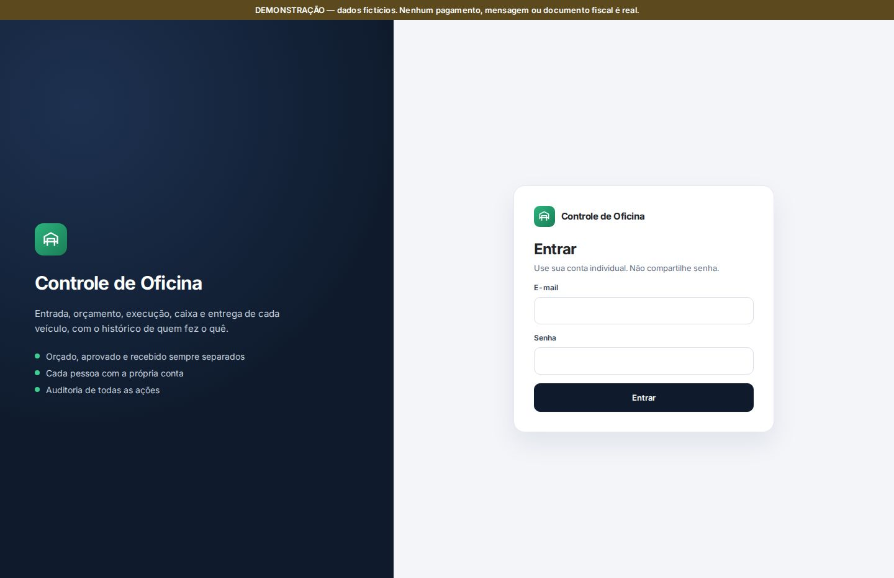

1. Digite seu **e-mail** e sua **senha**.
2. Clique em **Entrar**.

Cada pessoa usa a **própria conta**. Não empreste sua senha: tudo o que é feito fica registrado no seu nome.

Se o e-mail ou a senha estiverem errados, ou se a conta estiver desativada, aparece: *"E-mail ou senha incorretos, ou conta desativada."* Por segurança, o sistema não diz qual dos dois está errado. Depois de várias tentativas seguidas, ele pede para esperar um pouco antes de tentar de novo.

No celular a tela é a mesma, ajustada à largura:

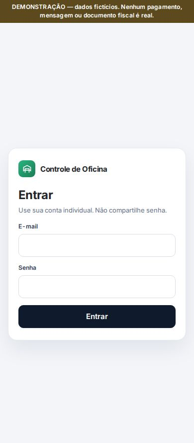

**Esqueceu a senha?** Peça ao dono para redefinir. Não existe "esqueci minha senha" automático.

### 4.2 Verificação em duas etapas (só para o dono)

Contas de **proprietário** têm uma proteção a mais. Depois da senha, o sistema pede um **código de 6 dígitos** gerado por um aplicativo autenticador no celular (por exemplo, Google Authenticator ou Microsoft Authenticator).

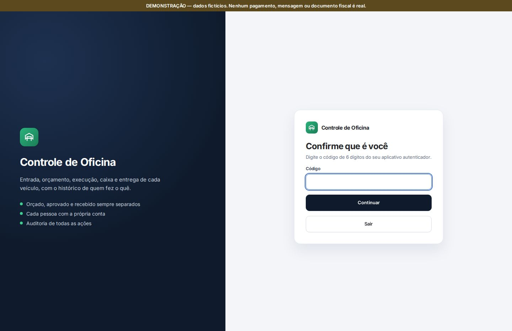

1. Abra o aplicativo autenticador no celular.
2. Digite o código de 6 dígitos que aparece para o Controle de Oficina.
3. Clique em **Continuar**.

O código muda a cada 30 segundos e não pode ser usado duas vezes. Se aparecer *"Código inválido ou já utilizado"*, espere o próximo código.

**Trocou ou perdeu o celular?** Outro proprietário pode gerar uma nova chave na tela do seu usuário (botão **Gerar nova chave**). A chave anterior deixa de funcionar.

### 4.3 Confirmar a senha antes de configurações sensíveis

Ao abrir telas de configuração (unidades, usuários, contas de recebimento, empresa etc.), o sistema pede a senha de novo se a última confirmação foi há mais de 15 minutos.

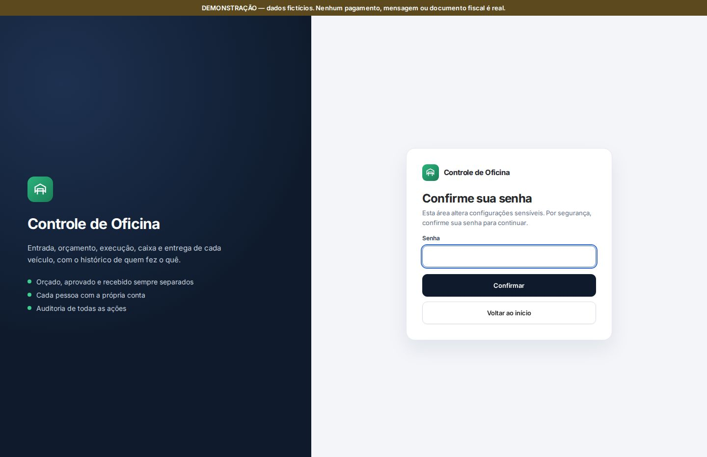

Digite sua senha e clique em **Confirmar**.

### 4.4 Sair

Clique em **Sair**, no fim do menu lateral ou no menu do seu nome (canto superior direito). Em computador compartilhado, sempre saia ao terminar.

## 5. Conhecendo a tela

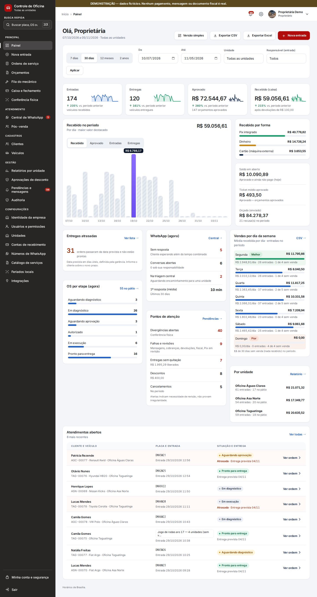

A tela tem três partes:

**Menu lateral (à esquerda).** Mostra só o que o seu papel pode usar. Os grupos são:

- **Principal:** Painel, Nova entrada, Ordens de serviço, Orçamentos, Fila do mecânico, Caixa (ou Recebimentos), Conferência física.
- **Atendimento:** Central de WhatsApp e Pós-venda.
- **Cadastros:** Clientes e Veículos.
- **Gestão:** Relatórios por unidade, Aprovações de desconto, Pendências e mensagens, Auditoria.
- **Configurações:** só para o dono (e Catálogo para o gerente).
- No rodapé: **Minha conta e segurança** e **Sair**.

Números em vermelho ao lado de um item indicam quantas coisas esperam por você (por exemplo, conversas de WhatsApp sem resposta ou pendências abertas).

No topo do menu fica a **Busca rápida**: digite uma placa, um número de OS, um nome ou um telefone e tecle Enter. O sistema abre a lista de ordens já filtrada.

**Barra superior.** Mostra onde você está (por exemplo, "Início › Painel"), o **sino de notificações**, a engrenagem de configurações (só o dono) e o **seu nome**.

O sino lista situações para revisar nas suas unidades:

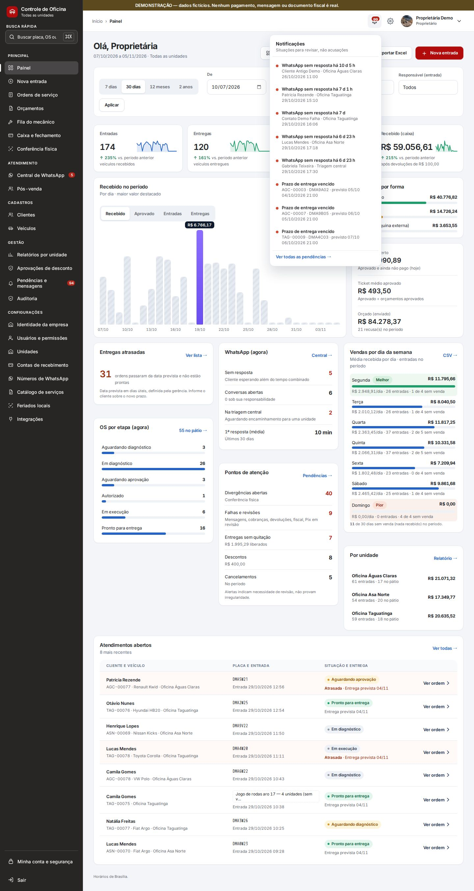

Clicando no seu nome, abre o menu da conta (perfil, alterar senha, sair):

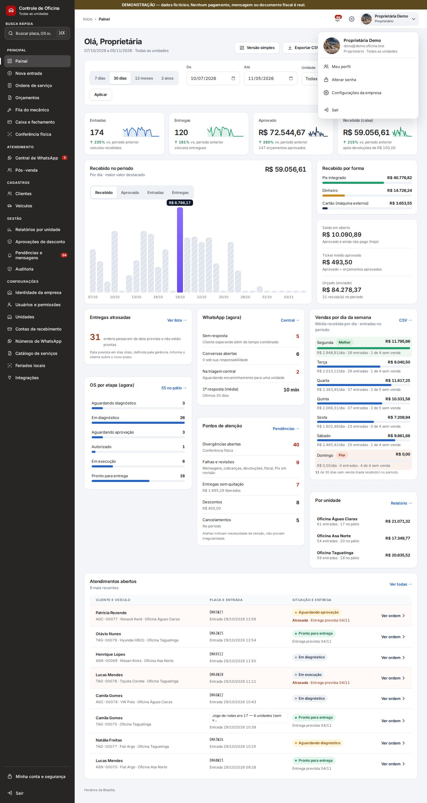

**No celular**, o menu lateral fica escondido. Toque no ícone de três linhas (☰) no canto superior esquerdo para abrir:

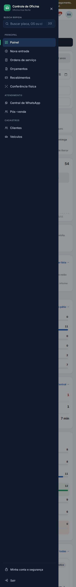

**Área principal.** É onde fica o conteúdo da página. No rodapé de todas as telas aparece "Horários de Brasília".

---

## 6. Recepção e caixa

A recepção recebe o cliente, registra a entrada, acompanha o orçamento, recebe o pagamento e entrega o veículo. Na demonstração, a conta usada nas fotos é `recepcao.asn@demo.oficina.test` (Oficina Asa Norte).

### 6.1 Painel da recepção

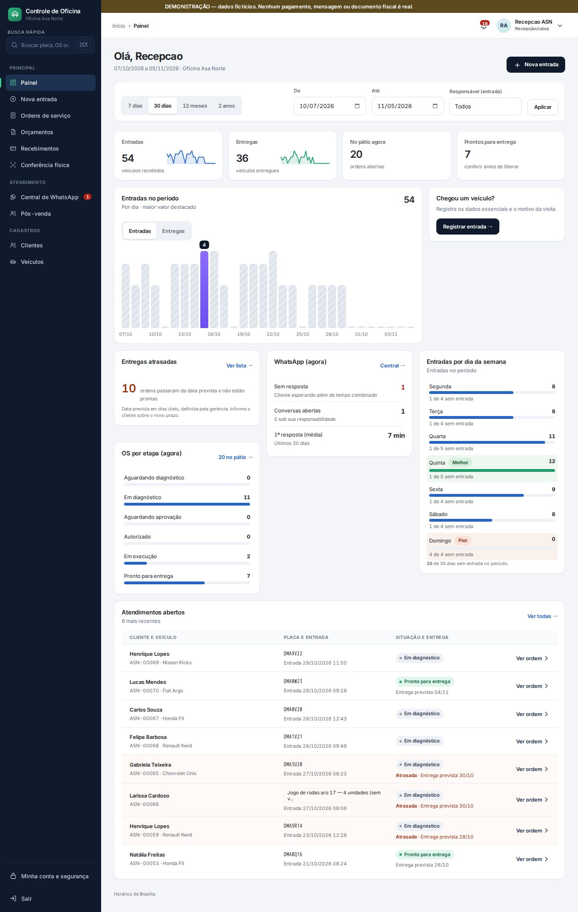

O painel da recepção **não mostra valores em dinheiro**. Ele mostra:

- **Entradas** e **Entregas** do período, com um pequeno gráfico.
- **No pátio agora:** ordens abertas.
- **Prontos para entrega:** veículos que já podem ser liberados (confira antes).
- **Entregas atrasadas:** ordens que passaram da data prevista e ainda não estão prontas. Clique em **Ver lista** para ver quais.
- **OS por etapa (agora):** quantas ordens estão em cada etapa. Clique em uma etapa para ver as ordens.
- **WhatsApp (agora):** conversas sem resposta e abertas.
- **Entradas por dia da semana.**
- **Atendimentos abertos:** as ordens mais recentes, com botão **Ver ordem**.

No alto, escolha o período (**7 dias, 30 dias, 12 meses, 2 anos**) ou as datas **De/Até** e clique em **Aplicar**. O botão vermelho **＋ Nova entrada** abre o registro de um veículo.

No celular:

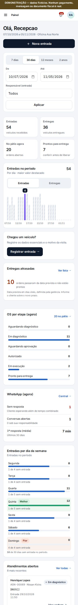

### 6.2 Registrar a entrada de um veículo

Menu **Nova entrada** (ou o botão **＋ Nova entrada** do painel).

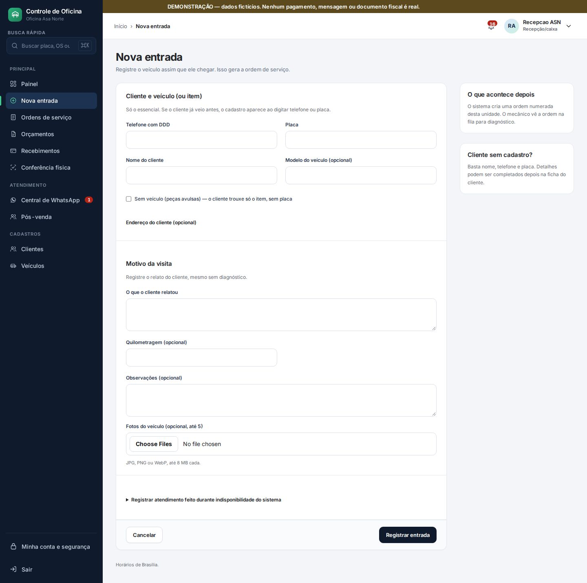

**Passo a passo:**

1. **Telefone com DDD** do cliente (só números, 10 ou 11 dígitos).
2. **Placa** do veículo.
3. **Nome do cliente.**
4. **Modelo do veículo** (opcional).
5. **Endereço do cliente** (opcional; clique para abrir). Se preencher, o endereço da ficha do cliente é atualizado.
6. Em **Motivo da visita**, escreva **o que o cliente relatou**, com as palavras dele, mesmo sem diagnóstico. É obrigatório.
7. **Quilometragem** e **Observações** (opcionais).
8. **Fotos do veículo** (opcional, até 5; JPG, PNG ou WebP, até 8 MB cada).
9. Clique em **Registrar entrada**.

O sistema cria a ordem numerada da unidade, e o mecânico passa a vê-la na fila para diagnóstico. O botão **Cancelar** volta ao painel sem gravar nada.

**Cliente que já veio antes.** Ao digitar o telefone ou a placa, o sistema procura o cadastro. Se encontrar, aparece o quadro **Cadastro encontrado** com nome, telefone e placas. Clique em **Usar este cadastro** para não duplicar o cliente.

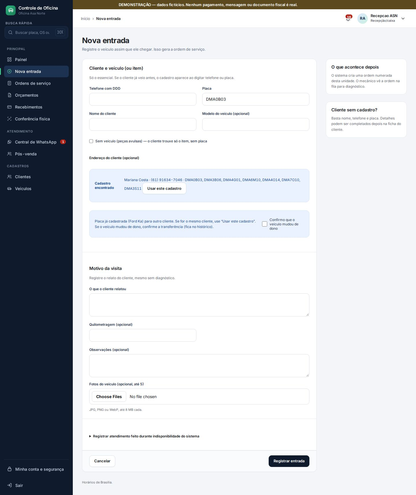

**Placa de outro dono.** Se a placa já estiver ligada a outro cliente, aparece um aviso. Se for o mesmo cliente, use **Usar este cadastro**. Se o carro mudou de dono, marque **Confirmo que o veículo mudou de dono** — a transferência fica registrada no histórico. Sem essa confirmação, o sistema não registra a entrada.

**Peças avulsas (sem veículo).** Quando o cliente traz só um item (por exemplo, um jogo de rodas), marque **Sem veículo (peças avulsas)**. O campo Placa some e aparece **Descrição do item**.

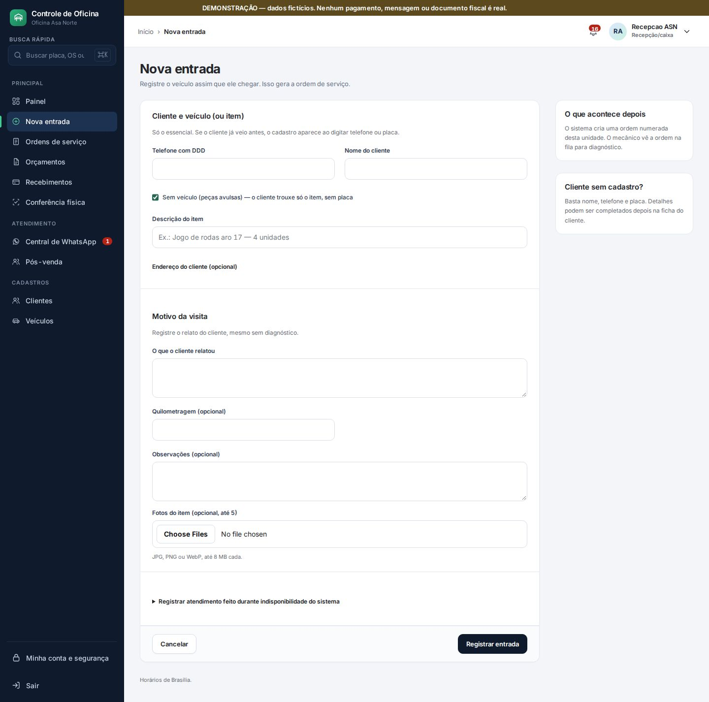

**Campos esquecidos.** Se faltar algo obrigatório, o sistema não grava e destaca o campo com a explicação:

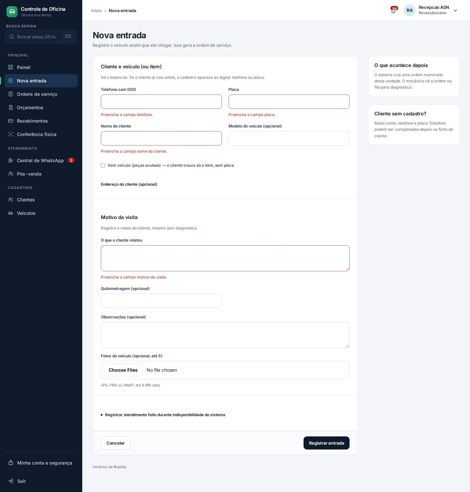

**Sistema fora do ar (contingência).** Se o sistema ficou indisponível e a entrada foi anotada em papel, abra **Registrar atendimento feito durante indisponibilidade do sistema**, marque **Esta entrada é de contingência** e informe o **horário original** e a **referência da anotação em papel**. O horário original precisa estar nos últimos 7 dias e não pode ser futuro. A OS fica marcada como contingência, com você como autor da regularização.

No celular, o formulário fica em uma coluna:

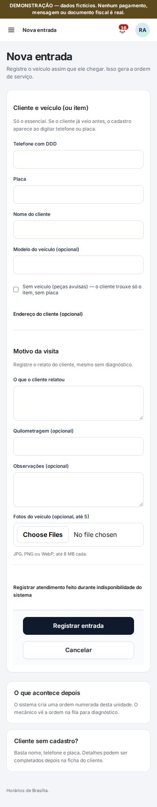

### 6.3 Encontrar uma ordem

Menu **Ordens de serviço**. Busque por **número, nome, telefone ou placa**, filtre por **Situação** e clique em **Filtrar**. Clique em **Ver ordem** para abrir.

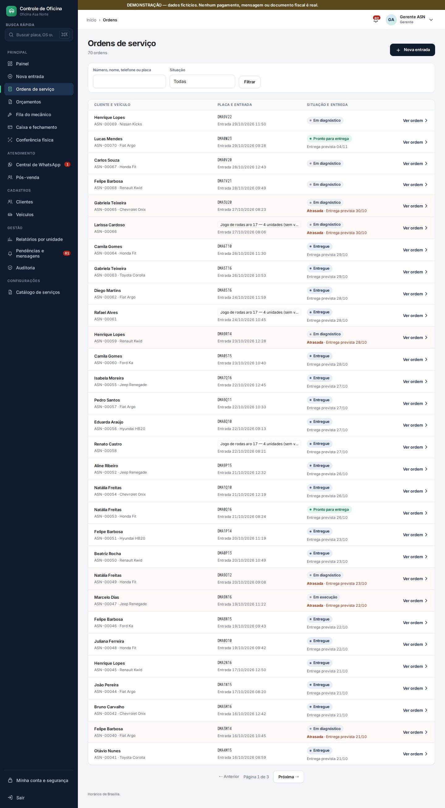

As linhas mostram cliente, veículo, placa, data de entrada, etapa atual e a data de entrega prevista. Ordens com entrega atrasada aparecem destacadas com "Atrasada".

### 6.4 Acompanhar o orçamento com o cliente

A recepção **não monta orçamento** (isso é do gerente), mas acompanha o cliente. Na OS, aba **Orçamento e execução**:

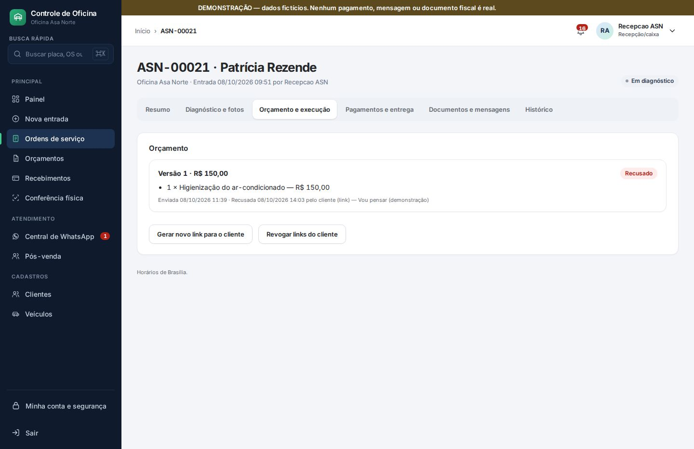

- Cada **versão** enviada aparece com itens, total e situação (aguardando decisão, aprovado, recusado).
- **Registrar decisão informada pessoalmente ou por telefone:** quando o cliente responde no balcão ou por telefone, escolha **Aprovou** ou **Recusou**, escreva **como o cliente decidiu** (ex.: "ligação às 10h, falou com Ana") e clique em **Registrar decisão**.
- **Gerar novo link para o cliente:** cria um novo endereço para o cliente ver e aprovar o orçamento e **desativa os links enviados antes**. O link aparece **uma única vez** na tela, logo após gerar. Copie e envie ao cliente. O link vale 30 dias.
- **Revogar links do cliente:** desativa todos os links já enviados (use se o link foi para a pessoa errada).

### 6.5 Receber o pagamento

Na OS, aba **Pagamentos e entrega**.

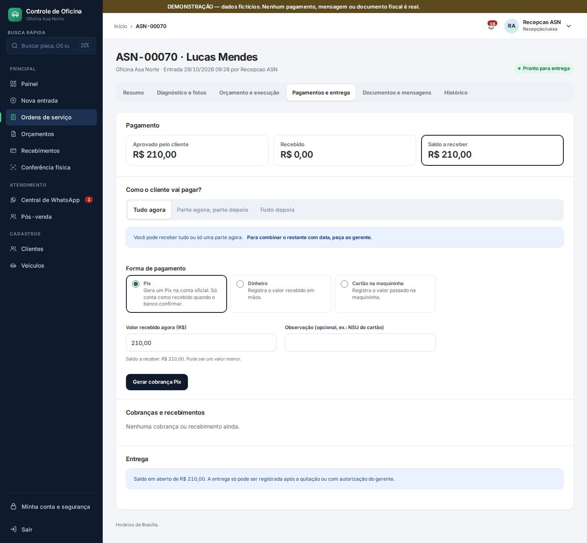

No alto aparecem três valores: **Aprovado pelo cliente**, **Recebido** e **Saldo a receber**.

Em **Como o cliente vai pagar?**:

1. Escolha a **forma de pagamento**:
   - **Pix:** gera uma cobrança Pix na conta oficial da unidade. **Só conta como recebido quando o banco confirmar.** Comprovante mostrado pelo cliente **não** quita a ordem.
   - **Dinheiro:** registra o valor recebido em mãos.
   - **Cartão na maquininha:** registra o valor passado na maquininha (que é separada do sistema).
2. Confira o **Valor recebido agora**. Já vem preenchido com o saldo, mas pode ser menor (pagamento parcial).
3. Se quiser, preencha **Observação** (ex.: número NSU do cartão).
4. Clique no botão (o texto muda conforme a forma: **Gerar cobrança Pix** ou **Confirmar pagamento**).

O sistema **bloqueia**:

- registrar Pix "à mão" — o Pix só é confirmado pelo banco;
- valor maior que o saldo;
- receber dinheiro depois que o caixa do dia foi fechado (peça ao gerente);
- cobrar Pix se a unidade não tiver conta oficial configurada (peça ao dono).

As opções **Parte agora, parte depois** e **Tudo depois** aparecem riscadas para a recepção. Para combinar o restante com data, **peça ao gerente** (ou ao dono que libere essa permissão para você). Veja [11.4](#114-aba-pagamentos-e-entrega).

### 6.6 Entregar o veículo

Ainda na aba **Pagamentos e entrega**, seção **Entrega** (só aparece quando a OS está **Pronto para entrega**):

- **Pago por completo:** aparece *"Pagamento quitado. Confira o veículo com o cliente antes de liberar."* Clique em **Registrar entrega ao cliente**.
- **Saldo coberto por pagamento combinado:** clique em **Registrar entrega com pagamento combinado**.
- **Ainda há saldo e não há combinado:** a recepção vê *"A entrega só pode ser registrada após a quitação ou com autorização do gerente."* e não consegue entregar. Chame o gerente.

### 6.7 Recebimentos do dia

Menu **Recebimentos**. Escolha o **Dia** e clique em **Ver**.

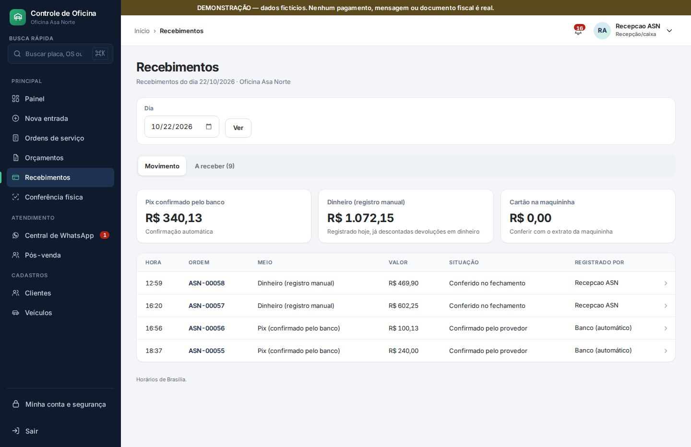

- **Movimento:** totais do dia (Pix confirmado pelo banco, Dinheiro, Cartão na maquininha) e a lista de cada recebimento: hora, ordem, meio, valor, situação e quem registrou. Recebimentos Pix aparecem como registrados por "Banco (automático)".
- **A receber:** ordens da unidade com saldo em aberto e a próxima parcela combinada, se houver.

A recepção **não vê** a aba **Fechamento** nem o "esperado na gaveta"; o fechamento é do gerente.

No celular, cada recebimento vira um cartão:

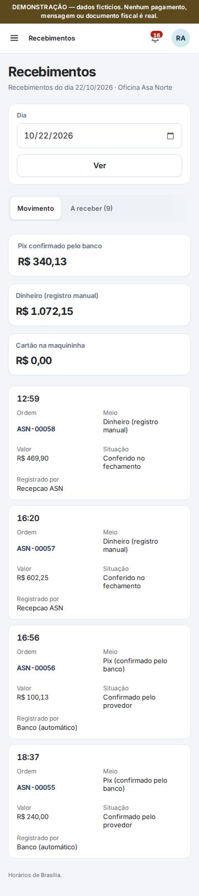

### 6.8 Conferência física do pátio

Menu **Conferência física**. Serve para conferir se os carros que deveriam estar na oficina estão mesmo lá.

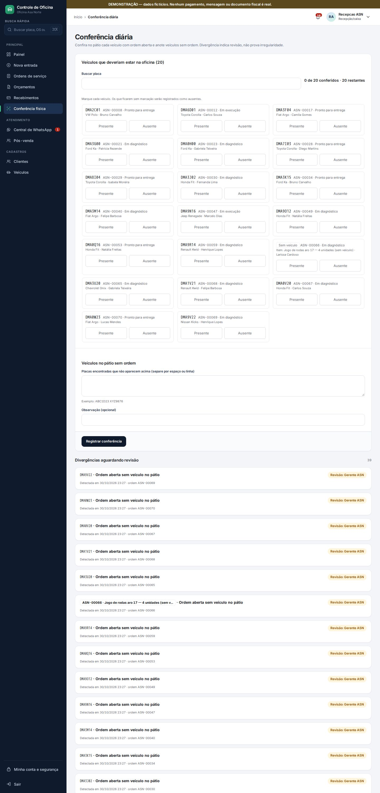

1. Em **Veículos que deveriam estar na oficina**, marque **Presente** ou **Ausente** em cada um. Use **Buscar placa** para achar rápido. O contador mostra quantos faltam.
2. Em **Veículos no pátio sem ordem**, digite as placas de carros encontrados que não estão na lista (separe por espaço ou linha).
3. Se quiser, escreva uma **Observação**.
4. Clique em **Registrar conferência**.

Veículos deixados sem marcação são registrados como **ausentes**. Ausências e carros sem ordem viram **divergências** para o gerente revisar. Divergência indica revisão, não prova irregularidade.

### 6.9 Clientes

Menu **Clientes**. Lista os clientes atendidos nas suas unidades, do mais recente para o mais antigo. Busque por nome, telefone ou placa.

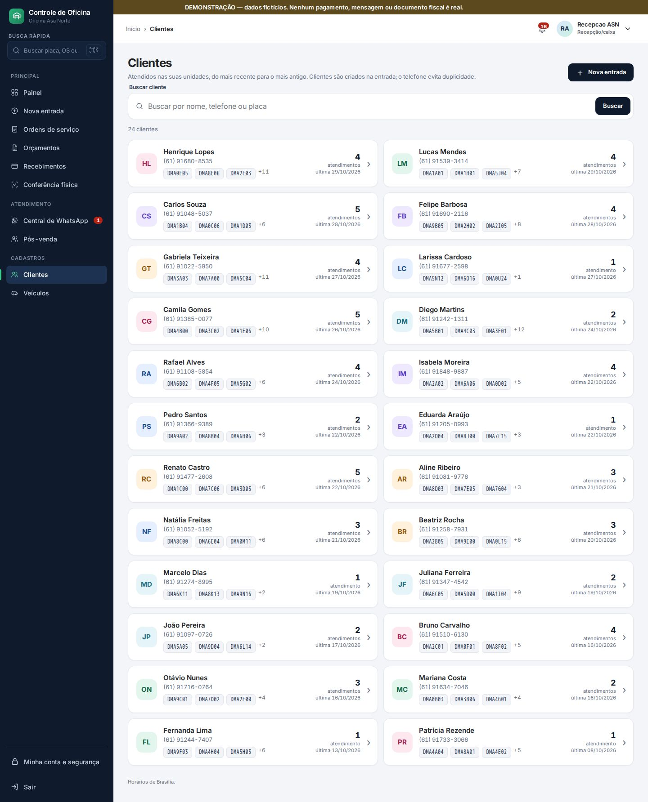

Clique em um cliente para abrir a ficha:

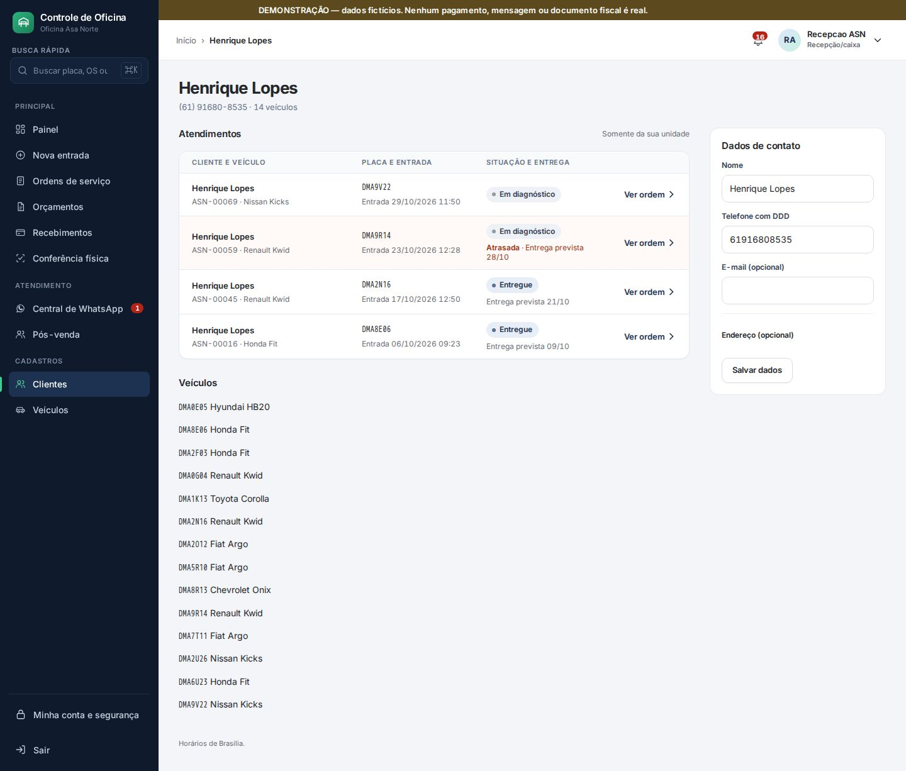

Na ficha você vê os **atendimentos**, os **veículos** e os **dados de contato** (nome, telefone, e-mail e endereço). Altere o que precisar e clique em **Salvar dados**.

Clientes são criados na entrada; o telefone evita duplicidade. Se houver outro cadastro com o mesmo telefone, o gerente vê o quadro **Possível cadastro duplicado** e pode **Unificar cadastros** (os atendimentos e veículos vão para a ficha atual; nada é apagado).

### 6.10 Veículos

Menu **Veículos**. Busque pela placa (completa ou parte dela) para ver os veículos atendidos e as ordens mais recentes de cada um.

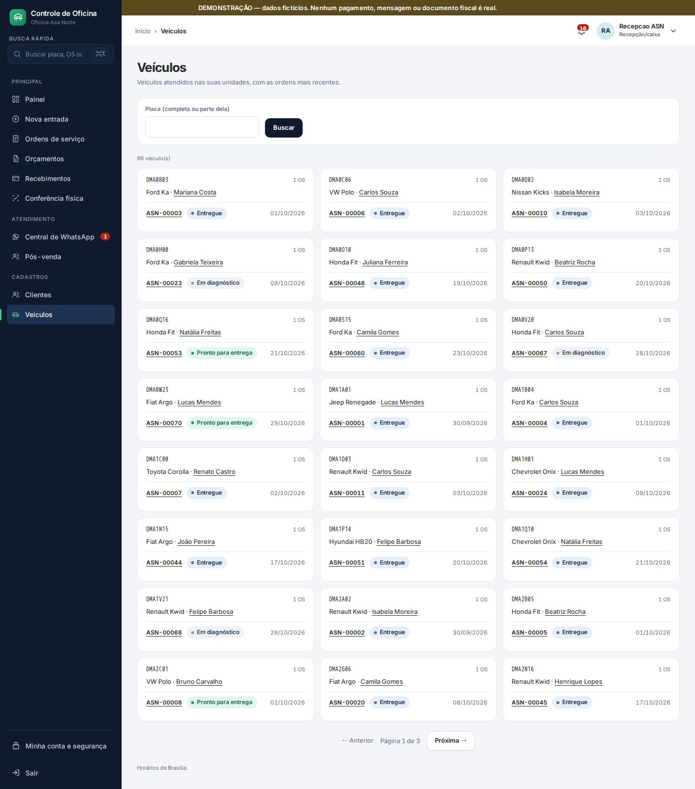

### 6.11 Central de WhatsApp

Menu **Central de WhatsApp**. Reúne as conversas que chegam nos números oficiais da empresa.

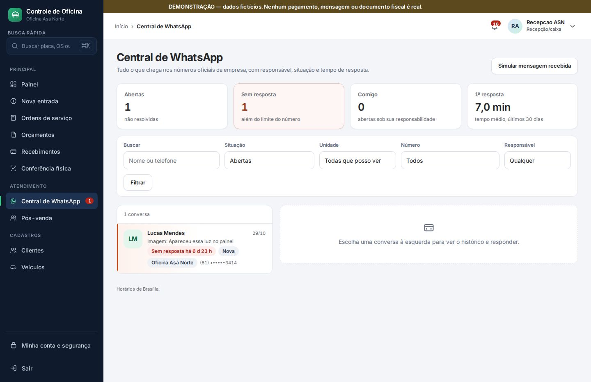

No alto: **Abertas**, **Sem resposta** (cliente esperando além do limite do número), **Comigo** e o **tempo médio da 1ª resposta**. Use os filtros (busca, situação, unidade, número, responsável) e clique em **Filtrar**.

Ao abrir uma conversa:

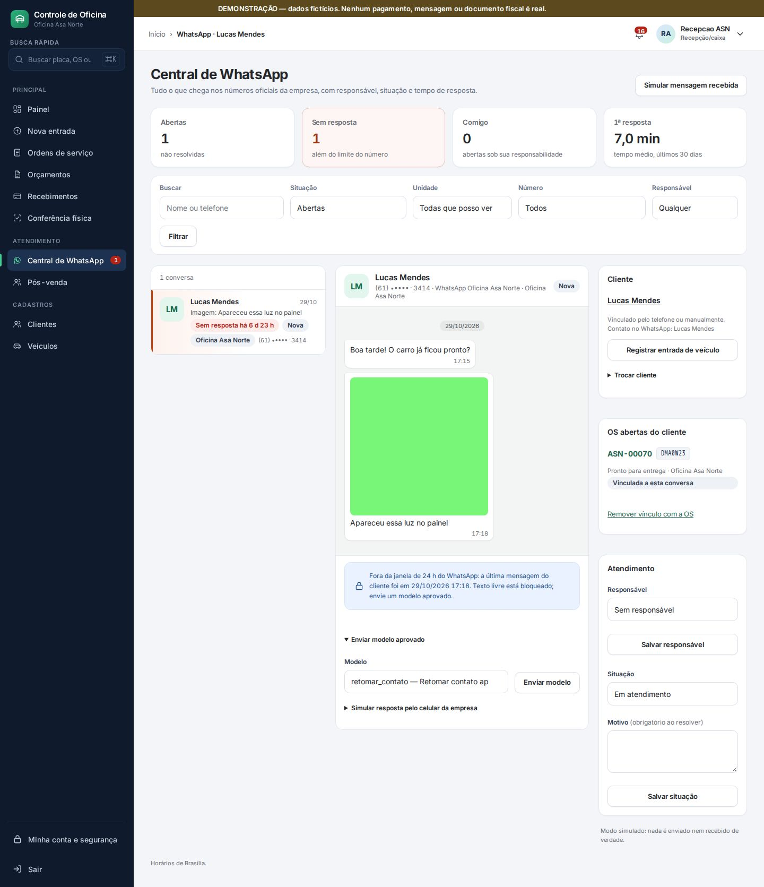

- **No meio:** as mensagens. Escreva a resposta e envie. Se o cliente não escreve há mais de 24 horas, o WhatsApp só permite enviar um **modelo aprovado** (o texto livre fica bloqueado) — escolha o modelo e clique em **Enviar modelo**.
- **Cliente:** vincule a conversa a um cliente (ou troque). Há um atalho **Registrar entrada de veículo**.
- **OS abertas do cliente:** ligue a conversa a uma OS.
- **Atendimento:** escolha o **Responsável** e a **Situação**. Para marcar como resolvida, o **Motivo** é obrigatório.

Na demonstração, aparecem botões de simulação (**Simular mensagem recebida**, **Simular resposta pelo celular da empresa**). Eles existem só para testes: **nada é enviado nem recebido de verdade**. Veja [15](#15-o-que-ainda-não-é-real).

O mecânico **nunca** acessa a Central de WhatsApp.

### 6.12 Pós-venda

Menu **Pós-venda**. Lista os clientes cujo carro foi entregue, para ligar e perguntar como foi o atendimento.

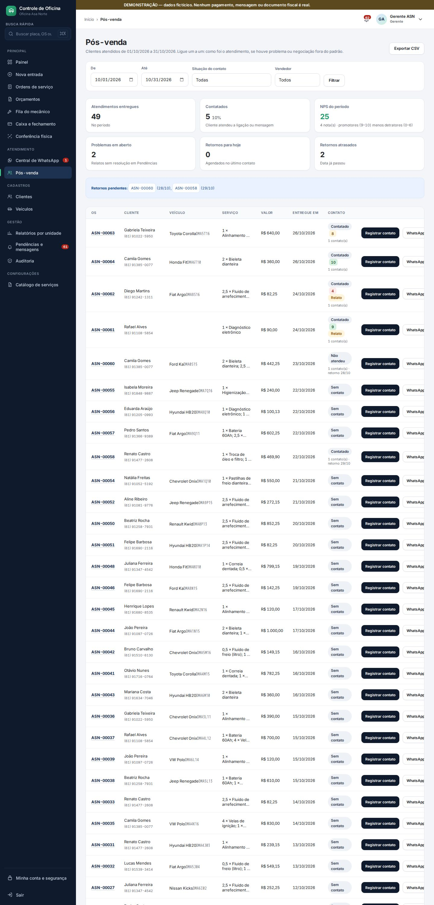

Filtre por período (**De/Até**), **Situação do contato** e **Vendedor**. Os indicadores mostram atendimentos entregues, contatados, a **nota NPS** do período, problemas em aberto e retornos para hoje ou atrasados. **Exportar CSV** baixa a lista em planilha.

Clique em um atendimento para registrar o contato:

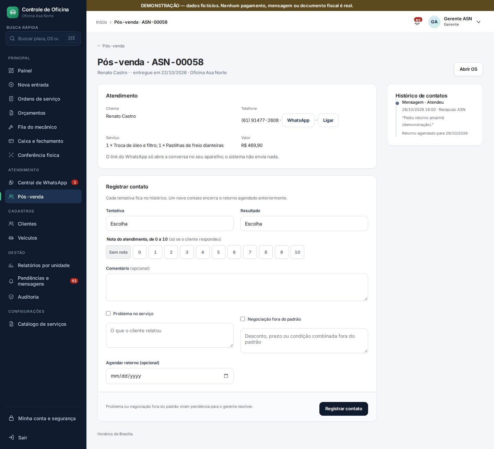

1. Use **WhatsApp** ou **Ligar** para falar com o cliente pelo seu aparelho. *O botão de WhatsApp só abre a conversa no seu aparelho; o sistema não envia nada.*
2. Em **Registrar contato**, escolha a **Tentativa** (Ligação ou Mensagem) e o **Resultado** (Atendeu, Não atendeu, Número errado).
3. Se o cliente respondeu, marque a **nota de 0 a 10**.
4. Marque **Problema no serviço** ou **Negociação fora do padrão**, se for o caso, e descreva. Esses casos viram **pendência** para o gerente resolver.
5. Se quiser, **Agende um retorno**.
6. Clique em **Registrar contato**.

Cada tentativa fica no **Histórico de contatos**. Um novo contato encerra o retorno agendado anteriormente.

---

## 7. Mecânico

O mecânico vê só o que precisa para trabalhar: os carros, os serviços e os prazos. **Ele nunca vê preços, valores, pagamentos nem o telefone do cliente.** Na demonstração, a conta é `mecanico.asn@demo.oficina.test`.

O menu do mecânico tem apenas **Painel** e **Fila do mecânico** (além de Minha conta e Sair).

### 7.1 Meu painel

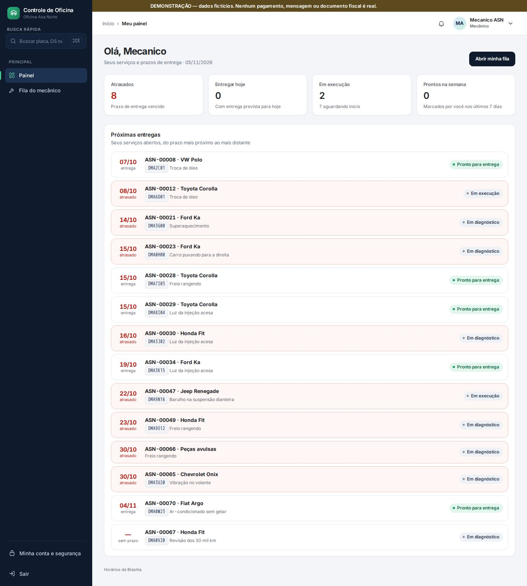

- **Atrasados:** serviços com prazo de entrega vencido.
- **Entregar hoje:** com entrega prevista para hoje.
- **Em execução** e quantos estão **aguardando início**.
- **Prontos na semana:** marcados por você nos últimos 7 dias.
- **Próximas entregas:** seus serviços abertos, do prazo mais próximo ao mais distante. Os atrasados ficam destacados em vermelho.

Se houver carros da unidade aguardando diagnóstico sem responsável, aparece um aviso com o link **Ver na fila**.

No celular:

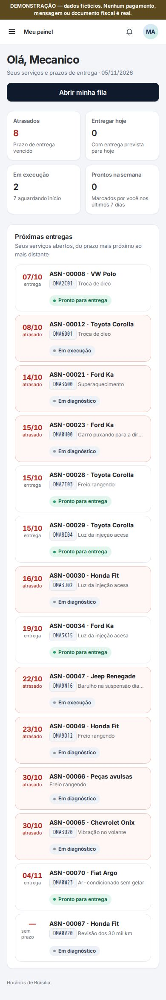

### 7.2 Minha fila

Menu **Fila do mecânico** (ou **Abrir minha fila**).

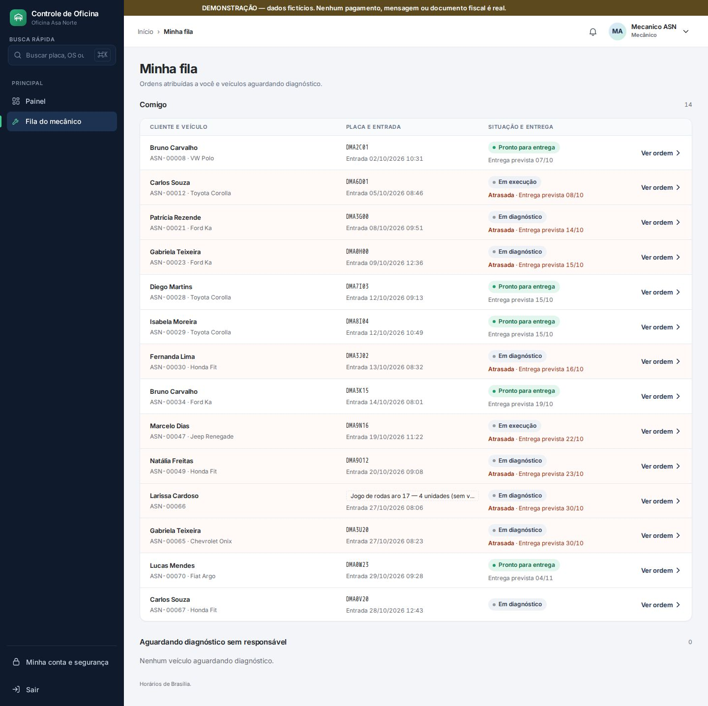

- **Comigo:** ordens atribuídas a você.
- **Aguardando diagnóstico sem responsável:** carros que ainda ninguém assumiu.

No celular:

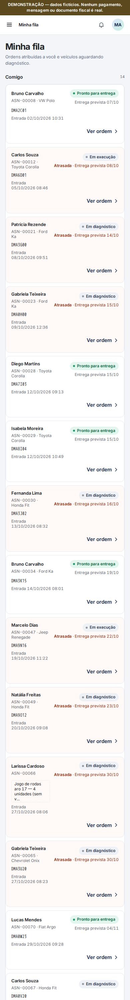

### 7.3 Fazer o diagnóstico

1. Abra a ordem na fila (**Ver ordem**).
2. Se a ordem estiver **Aguardando diagnóstico**, clique em **Iniciar diagnóstico**. Se ninguém era responsável, a ordem passa a ser sua. Se outro mecânico já assumiu, o sistema avisa: *"Esta ordem já foi assumida por outro mecânico."*
3. Vá à aba **Diagnóstico e fotos**.
4. Em **O que foi encontrado**, escreva o diagnóstico e clique em **Salvar diagnóstico**.
5. Em **Adicionar foto**, escolha a imagem (JPG, PNG ou WebP) e clique em **Enviar foto**.

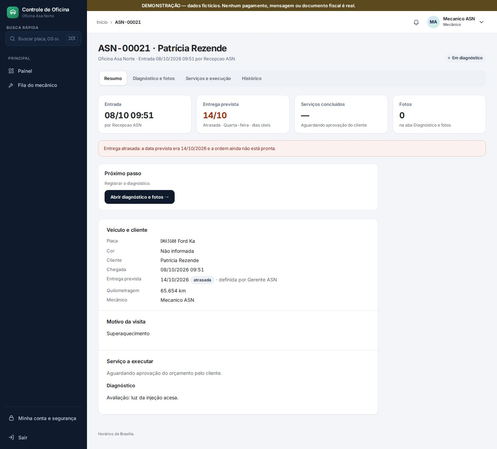

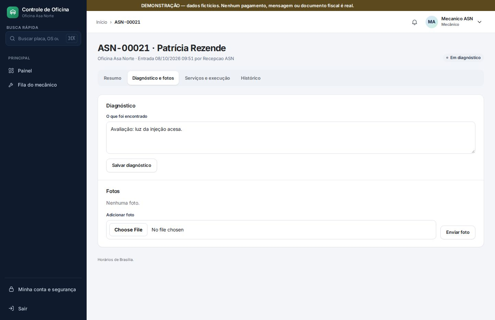

O diagnóstico só pode ser registrado com a ordem **em diagnóstico**, **aguardando aprovação** ou **em execução**. Depois disso, o gerente monta o orçamento.

### 7.4 Executar os serviços

Quando o cliente aprova, a ordem fica **Autorizado**. Na aba **Serviços e execução**:

1. Clique em **Iniciar execução**.
2. Ao terminar cada serviço, clique em **Marcar como concluído**. O sistema registra quem concluiu e quando.
3. Quando todos estiverem concluídos, escreva o **Resultado do serviço** (opcional) e clique em **Liberar para entrega**.

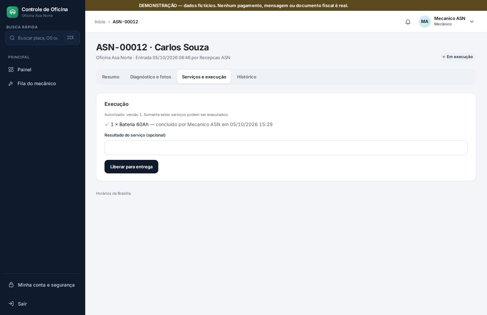

O sistema **bloqueia**:

- executar serviço que **não está na versão aprovada** pelo cliente (*"Este serviço não está autorizado pelo cliente."*);
- concluir serviço antes de iniciar a execução;
- liberar para entrega com algum serviço pendente (*"Conclua todos os serviços autorizados antes de liberar para entrega."*).

Se precisar de um serviço a mais, avise o gerente: ele envia uma nova versão do orçamento como **extra**, e o serviço só pode ser feito depois que o cliente aprovar.

No celular:

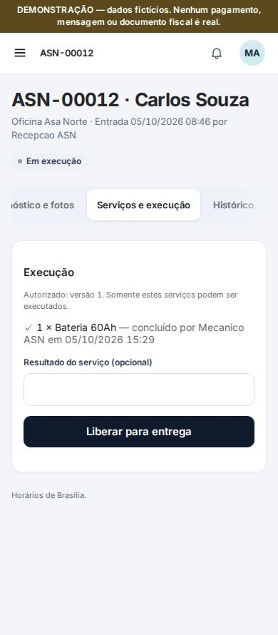

### 7.5 O que o mecânico não consegue abrir

O mecânico não abre ordens de outros mecânicos, ordens de outras unidades, caixa, clientes ou configurações. Se tentar, vê a tela **Acesso negado**:

---

## 8. Gerente

O gerente cuida de uma unidade: monta orçamentos, define prazos, dá descontos, fecha o caixa, resolve pendências e acompanha os números. Ele também pode fazer tudo o que a recepção faz. Na demonstração, a conta é `gerente.asn@demo.oficina.test`.

### 8.1 Painel do gerente

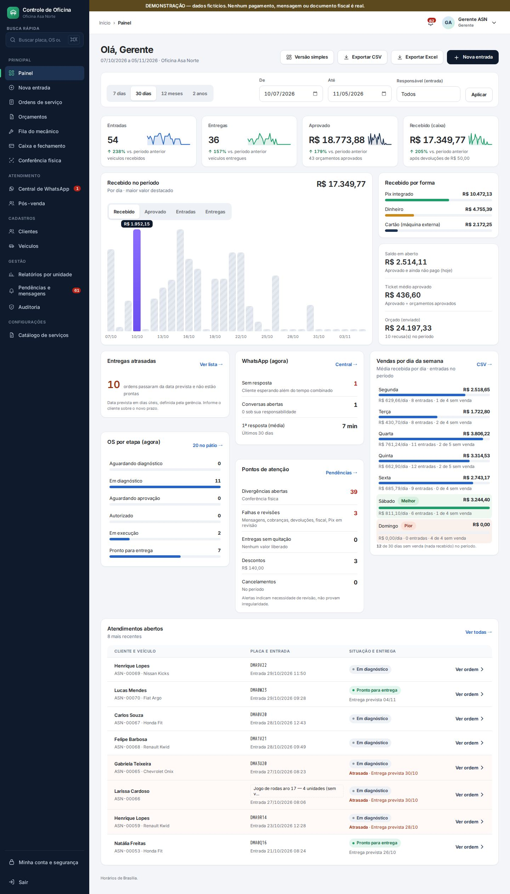

Além do que a recepção vê, o gerente vê os valores:

- **Aprovado** (e quantos orçamentos foram aprovados) e **Recebido (caixa)**, com comparação ao período anterior.
- **Gráfico** do período: troque entre **Recebido, Aprovado, Entradas e Entregas**. Cada barra é um link que abre as ordens daquele dia.
- **Recebido por forma:** Pix, dinheiro e cartão.
- **Saldo em aberto**, **Ticket médio aprovado** e **Orçado (enviado)**, com o número de recusas.
- **Pontos de atenção:** divergências abertas, falhas e revisões, entregas sem quitação, descontos e cancelamentos.
- **Vendas por dia da semana**, com o melhor e o pior dia.

Botões do alto:

- **Versão simples:** resumo em linguagem direta (veja [10.2](#102-painel-versão-simples)).
- **Exportar CSV** e **Exportar Excel:** baixam os números do período.
- **Responsável (entrada):** filtra só as ordens cuja entrada foi registrada por uma pessoa.

### 8.2 Montar e enviar um orçamento

Na OS (etapa **Em diagnóstico**), aba **Orçamento e execução**.

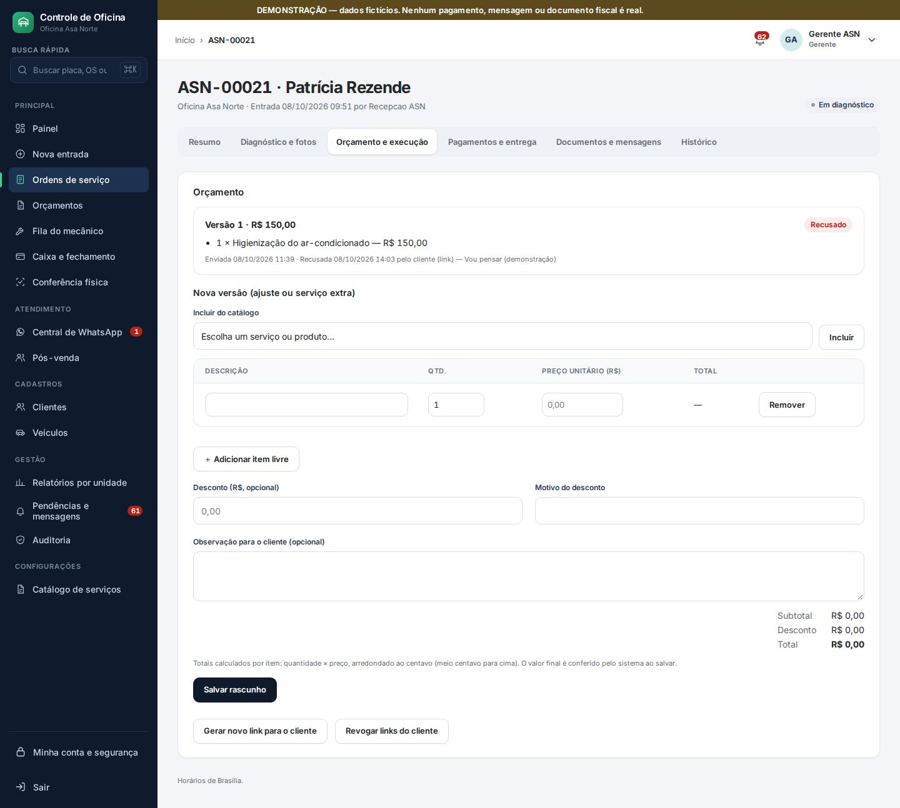

1. Em **Incluir do catálogo**, escolha um serviço ou produto e clique em **Incluir**. O preço de tabela da unidade vem preenchido.
2. Para algo fora do catálogo, clique em **＋ Adicionar item livre** e preencha **Descrição**, **Qtd.** e **Preço unitário**.
3. Se aparecerem **Adicionais sugeridos**, você pode incluí-los com um clique.
4. Se for o caso, informe **Desconto (R$)** e o **Motivo do desconto** (obrigatório quando há desconto). Itens do catálogo também aceitam desconto em % sobre a tabela.
5. Escreva uma **Observação para o cliente** (opcional).
6. Confira **Subtotal**, **Desconto** e **Total**. O total é calculado item por item (quantidade × preço, arredondado ao centavo).
7. Clique em **Salvar rascunho**.
8. Informe o **Prazo de entrega em dias úteis** (opcional) e clique em **Enviar versão N ao cliente**.

Ao enviar, a OS vai para **Aguardando aprovação** e o sistema mostra o **link para o cliente** uma única vez. Na demonstração, a mensagem ao cliente é apenas simulada.

**Regras e bloqueios:**

- O desconto não pode ser maior que o subtotal.
- Quem não tem permissão de desconto vê *"Descontos exigem permissão de gerente."*
- **Desconto acima do limite** do catálogo (ou da regra geral): ao salvar, o pedido vai para **aprovação interna** e o orçamento **só pode ser enviado depois de aprovado** (veja [8.3](#83-aprovações-de-desconto)).
- Não é possível enviar se houver outra versão aguardando decisão do cliente.
- Cada envio cria uma **nova versão**. As versões antigas ficam guardadas.

**Serviço extra durante a execução.** Com a OS **Em execução**, o editor mostra *"Serviços novos entram como extra e só podem ser executados após nova aprovação do cliente."* Monte a nova versão e envie.

Veja também como fica uma OS aguardando a resposta do cliente (com a opção de registrar a decisão dada pessoalmente):

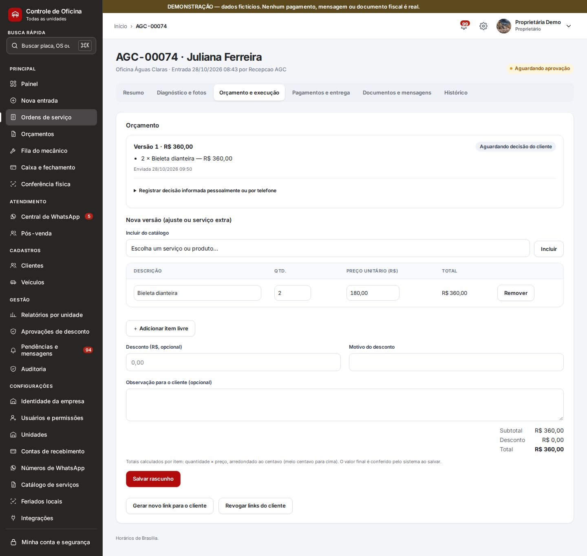

E uma OS já **Autorizado**, pronta para o mecânico iniciar:

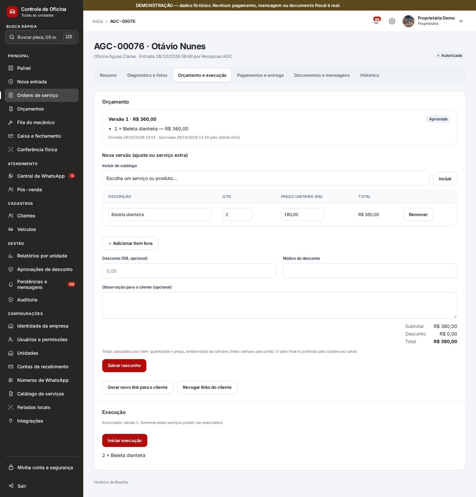

### 8.3 Aprovações de desconto

Menu **Aprovações de desconto** (aparece para quem pode aprovar: o dono e quem recebeu essa permissão).

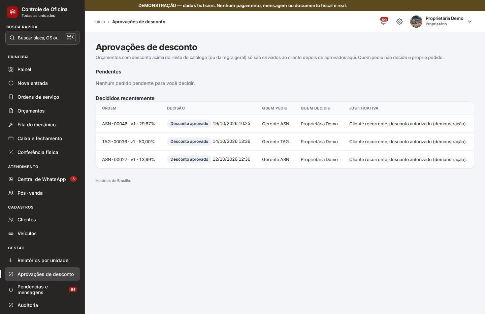

Cada pedido pendente mostra a ordem, quem pediu e o motivo. Escreva a **Justificativa** (obrigatória, de 5 a 500 caracteres) e clique em **Aprovar desconto** ou **Recusar**. **Quem pediu não decide o próprio pedido** (exceto o proprietário). Se o orçamento for alterado depois do pedido, o pedido é cancelado.

### 8.4 Prazo de entrega, mecânico e vendedor

Na aba **Resumo** da OS, à direita, há quadros que abrem com um clique:

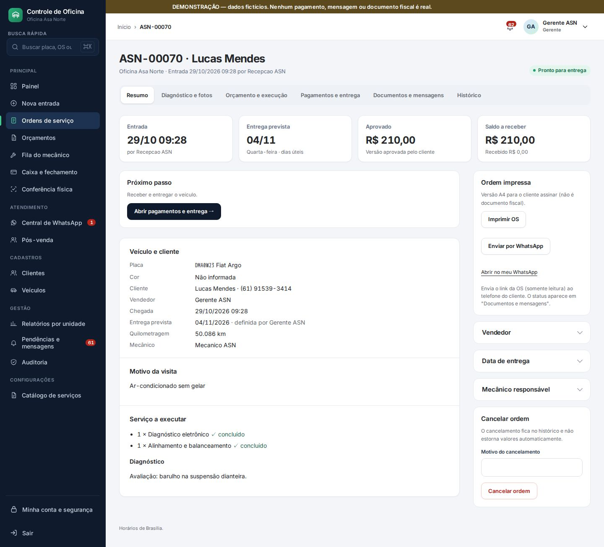

- **Data de entrega** (gerente, supervisor e dono): informe o **prazo em dias úteis** (segunda a sexta, sem feriados, a partir de hoje) **ou** escolha a **data**. Clique em **Definir data** (ou **Alterar data**). O sistema recusa data no passado, dia não útil e prazo acima de 120 dias úteis.
- **Mecânico responsável** (recepção, gerente e dono): escolha o mecânico ativo da unidade e clique em **Atribuir**.
- **Vendedor** (gerente e dono): quem fechou a venda. Se ninguém escolher, ele é definido ao enviar o orçamento.
- **Cancelar ordem** (quem tem permissão): escreva o **motivo** e clique em **Cancelar ordem**. O cancelamento fica no histórico e **não estorna valores automaticamente**.

### 8.5 Receber, combinar parcelas e liberar sem pagamento

Na aba **Pagamentos e entrega**, o gerente tem as três opções de **Como o cliente vai pagar?**:

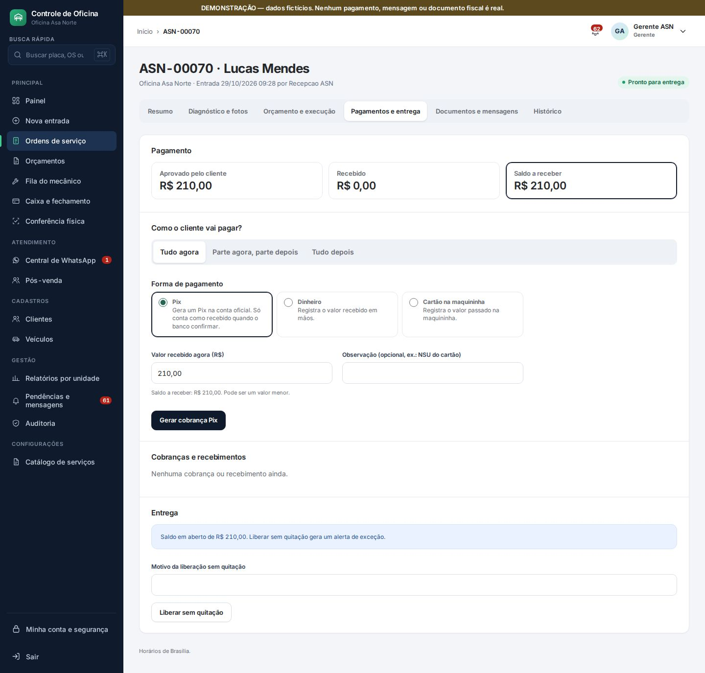

**Parte agora, parte depois:** informe quanto o cliente paga agora e a forma, depois a **data** e o **valor** do restante (até 3 datas) e como vai pagar. Clique em **Registrar combinado e receber agora**.

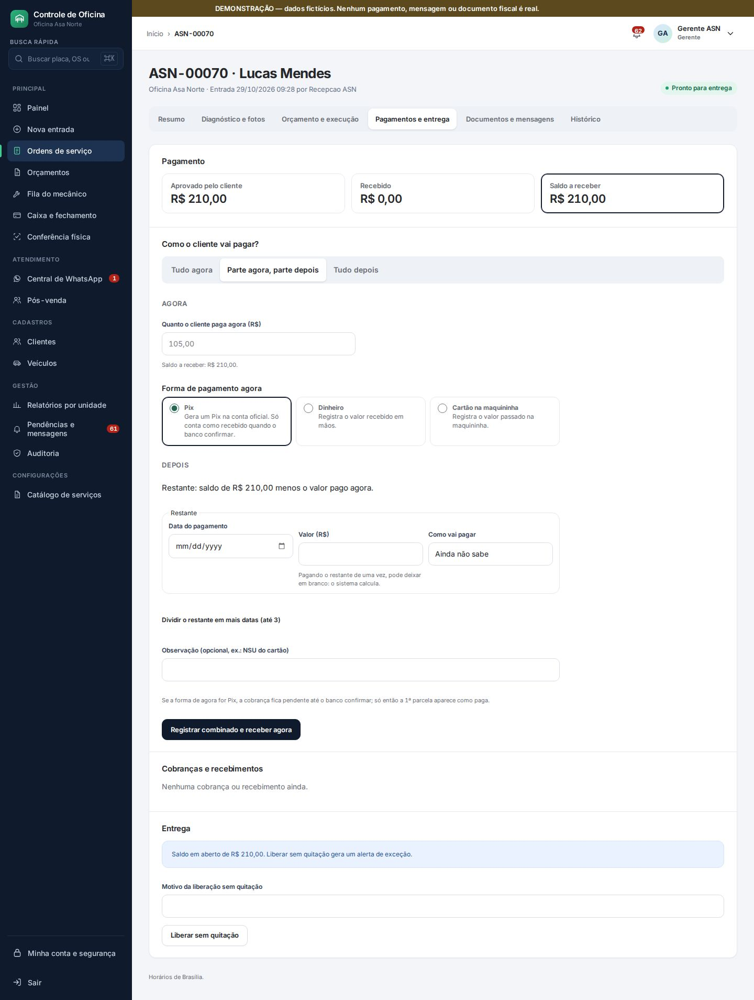

**Tudo depois:** nada é recebido agora. Informe até 3 datas e valores; **a soma precisa ser igual ao saldo**. Clique em **Registrar combinado**.

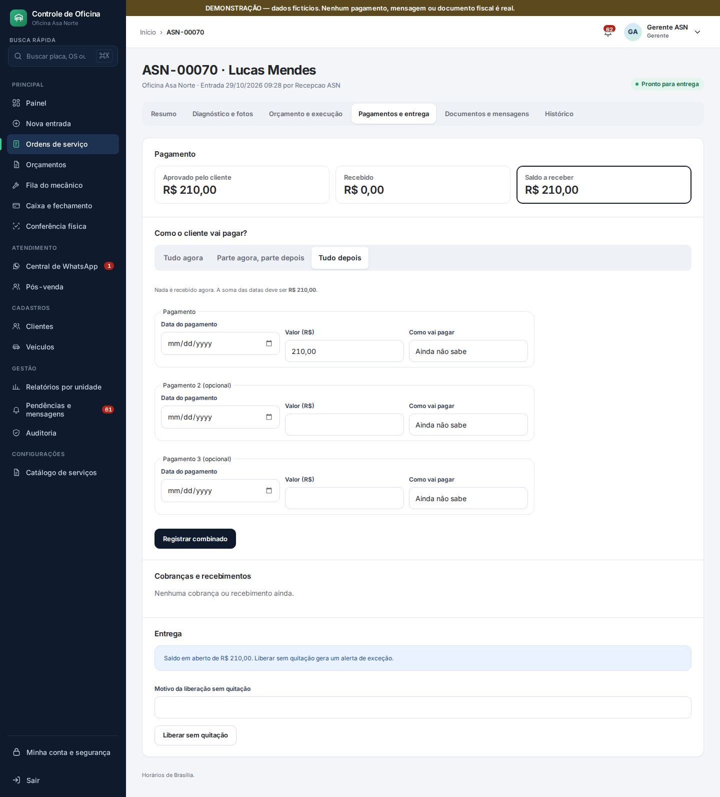

Com o combinado registrado, a aba mostra as **Parcelas combinadas** (paga, em aberto, vencida) e permite **Ajustar combinado** ou **Cancelar combinado** (ambos pedem motivo). Com o saldo coberto pelo combinado, a entrega pode ser registrada **sem exceção**.

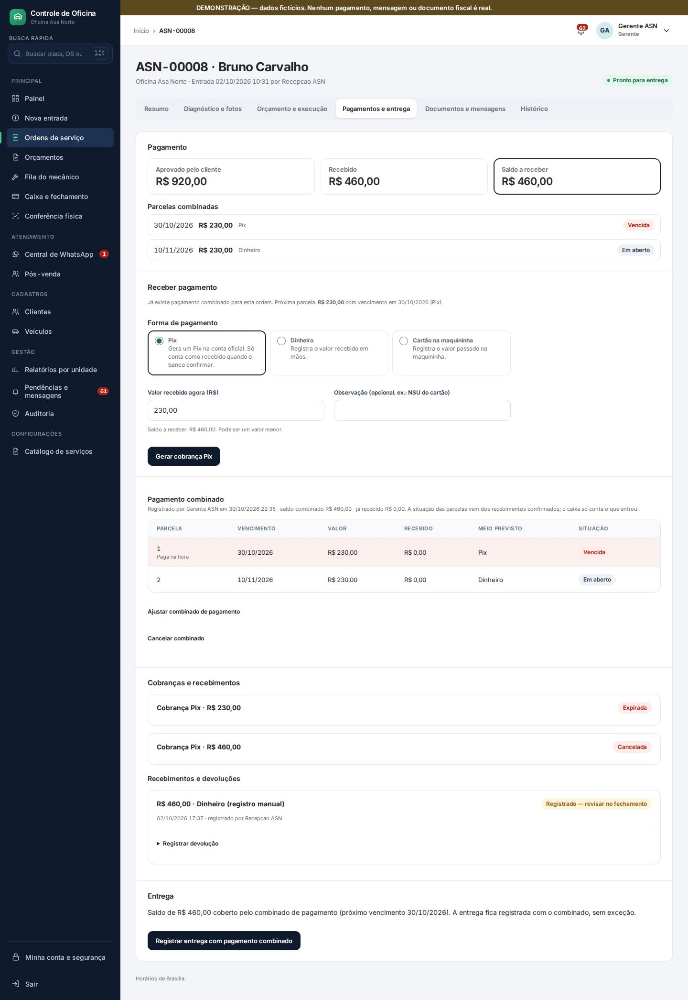

**Liberar sem quitação.** Se ainda houver saldo sem combinado, o gerente vê *"Liberar sem quitação gera um alerta de exceção."* Escreva o **motivo** e clique em **Liberar sem quitação**. A entrega fica marcada como exceção, aparece nos pontos de atenção e nas pendências, e o saldo continua a receber.

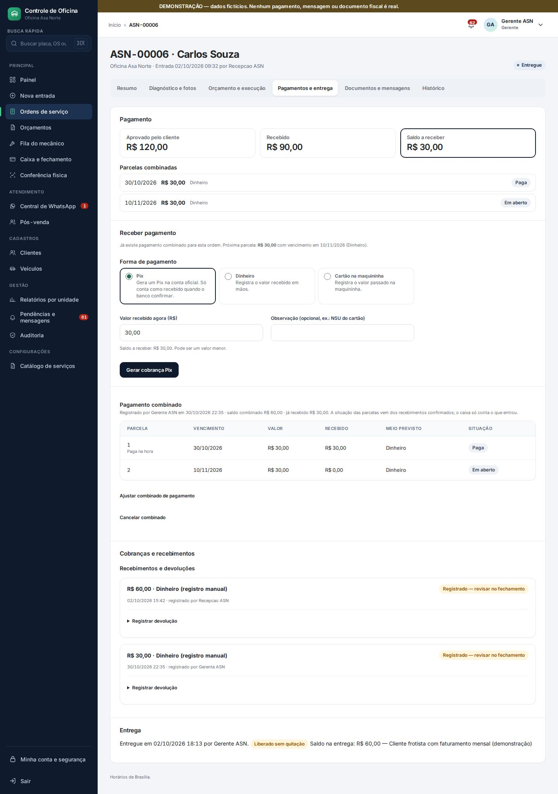

**Pix em revisão.** Se o banco confirmar um valor **diferente** do cobrado, o recebimento fica **Em revisão** e **não quita** a ordem. O gerente confere e usa **Aceitar após conferência** (escrevendo o que foi conferido) ou **Registrar devolução**.

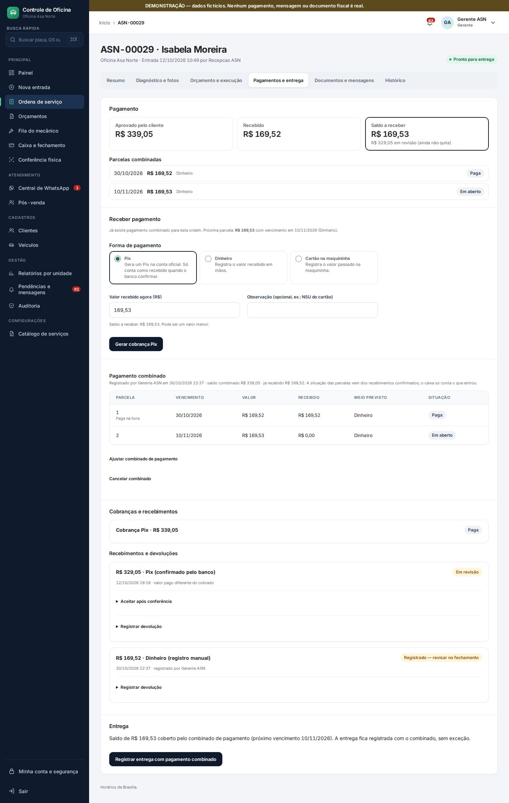

**Devolução.** Em cada recebimento, **Registrar devolução** pede o valor e o motivo. O valor não pode passar do disponível. Se uma devolução Pix falhar, aparece **Tentar de novo** e *"Nenhum valor saiu da conta."*

### 8.6 Caixa e fechamento

Menu **Caixa e fechamento**. Escolha o **Dia** e clique em **Ver**.

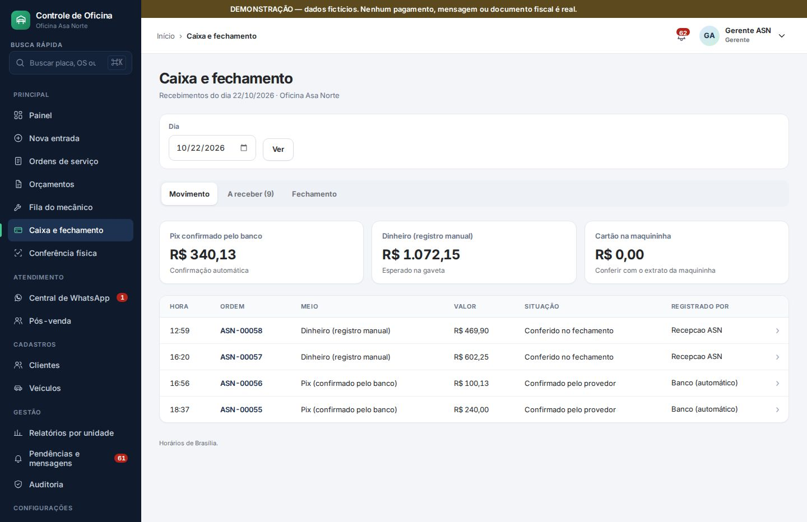

- **Movimento:** igual à recepção, mas o dinheiro aparece como **"Esperado na gaveta"**.
- **A receber:** ordens com saldo, etapa e próxima parcela (parcelas vencidas destacadas).

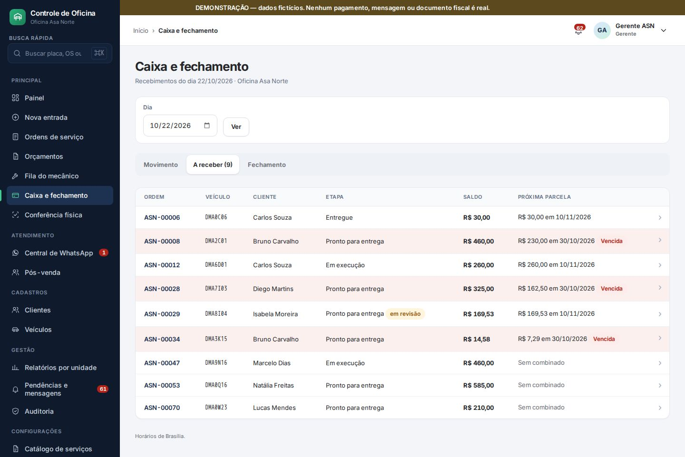

- **Fechamento:** no fim do dia, conte o dinheiro da gaveta, digite em **Dinheiro contado no caixa (R$)**, escreva uma observação se precisar e clique em **Fechar caixa do dia**.

Depois de fechado, o dia mostra o valor do sistema, o contado e a **diferença**:

Cada dia só pode ser fechado uma vez. Depois do fechamento, a recepção não consegue registrar novos recebimentos em dinheiro naquele dia. O cartão deve ser conferido com o extrato da maquininha.

### 8.7 Orçamentos e versões

Menu **Orçamentos**. Lista as versões enviadas da unidade, filtrando por **Situação** (por padrão, as que aguardam decisão). Rascunhos ficam dentro de cada ordem até serem enviados.

### 8.8 Pendências e mensagens

Menu **Pendências e mensagens**. Junta tudo o que precisa de revisão nas suas unidades:

Tipos de pendência: entrega sem quitação, falha de cobrança, mensagem que falhou, documento fiscal rejeitado, devolução que falhou, Pix em revisão, divergência de conferência e relatos do pós-venda (problema no serviço ou negociação fora do padrão).

Para resolver, escreva **O que foi verificado e decidido** e clique em **Salvar resolução**. A resolução fica registrada com seu nome e a data. Pix em revisão é resolvido na própria OS.

Na parte de mensagens, **Tentar de novo** reenvia uma mensagem que falhou e **Processar fila agora** recoloca na fila mensagens paradas há mais de 5 minutos.

### 8.9 Divergências da conferência

Na tela **Conferência física** (veja [6.8](#68-conferência-física-do-pátio)), o gerente também vê **Divergências aguardando revisão**. Para cada uma, escreva **O que foi verificado e decidido** e clique em **Registrar resolução**. As resolvidas aparecem em **Resolvidas recentemente**.

### 8.10 Indicadores da loja

Menu **Relatórios por unidade**. Mostra entradas e saídas, orçado, aprovado, recebido, a receber, descontos, cancelamentos, entregas sem quitação, falhas e divergências do período, além das ordens abertas por etapa. Valores recebidos contam só transações efetivas.

### 8.11 Catálogo de serviços

Menu **Catálogo de serviços**. É a tabela de preços usada nos orçamentos.

- **Novo item:** nome, categoria, unidade de venda, preço padrão e **desconto máximo sem aprovação (%)**. Em branco, vale a regra geral. Clique em **Incluir no catálogo**.
- **Importar tabela (CSV):** um item por linha, separado por ponto e vírgula. O sistema mostra um relatório das linhas recusadas.
- Clique em um item para editar:

Na edição há **Preço por unidade** (opcional; só aparecem as unidades em que você atua), **Adicionais sugeridos** (aparecem como sugestão no orçamento) e o **Histórico de preço**.

O **desconto máximo** só pode ser alterado pelo dono ou por quem aprova descontos.

### 8.12 Auditoria (histórico de ações)

Menu **Auditoria**. Registros permanentes: **não podem ser editados nem apagados**.

Filtre por **Unidade**, **Ação** e período (**De/Até**). Cada linha mostra quando, quem, unidade, ação, registro, motivo e o "antes/depois" da alteração. O botão de exportação baixa os registros filtrados.

Até ações simples ficam registradas, como imprimir uma OS ou trocar a versão do painel.

---

## 9. Supervisor

O supervisor tem **a mesma visão e as mesmas permissões do gerente**, mas em **várias unidades** (as que o dono marcou). No painel ele pode escolher a unidade ou ver todas as que supervisiona. Na demonstração, a conta é `supervisor@demo.oficina.test` (Taguatinga e Águas Claras).

### 9.1 Feriados locais

Só o supervisor (nas suas unidades) e o dono cadastram **feriados estaduais e municipais**. Eles se somam aos feriados nacionais no cálculo da data de entrega em dias úteis.

1. Escolha a **Unidade** e clique em **Ver**.
2. Informe a **Data** e a **Descrição** (ex.: "Aniversário de Goiânia").
3. Clique em **Cadastrar feriado**.

O feriado vale para prazos definidos **a partir de agora**. Prazos já definidos não são recalculados. Para tirar um feriado, use **Remover**.

---

## 10. Dono (proprietário)

O dono vê **todas as unidades** e é o único que mexe nas configurações. Na demonstração, a conta é `dono@demo.oficina.test` (com verificação em duas etapas).

### 10.0 Primeiro acesso: o que fazer antes de tudo

Logo depois de criada a conta, o sistema ainda não tem nenhuma oficina cadastrada. O painel mostra *"Nenhuma unidade ativa"*. Caixa, Conferência física, Feriados e Nova entrada mostram *"Nenhuma unidade cadastrada"*, com o botão **Cadastrar unidade**. Siga esta ordem:

1. **Identidade da empresa** (veja [10.4](#104-identidade-da-empresa)): nome, CNPJ e logo.
2. **Unidades** (veja [10.5](#105-unidades)): cadastre cada oficina. Sem unidade, ninguém registra entrada nem abre o caixa.
3. **Contas oficiais de recebimento** (veja [10.7](#107-contas-oficiais-de-recebimento)): uma por unidade.
4. **Usuários** (veja [10.6](#106-usuários-e-permissões)): gerentes, recepção e mecânicos, cada um na sua unidade.

### 10.1 Painel completo

É o painel do gerente com duas diferenças: filtro por **Unidade** (ou todas) e o quadro **Por unidade**, que mostra entradas, carros no pátio e valor recebido de cada loja. Clique em uma loja para ver só ela.

### 10.2 Painel versão simples

Clique em **Versão simples** no painel. É um resumo de hoje em linguagem direta, sem gráficos:

- **Quantos carros estão na oficina? Quantos estão prontos? Quanto entrou de dinheiro hoje? Quanto falta receber?**
- **O que precisa ser feito:** lista de tarefas, com as urgentes marcadas.
- **Como está cada loja:** carros na loja, prontos, atrasados, esperando aprovação e recebido hoje.

Para voltar, clique em **Painel completo**. A escolha fica salva na sua conta. A versão simples existe para quem vê indicadores (gerente, supervisor e dono).

### 10.3 Painel central (indicadores de todas as unidades)

Menu **Relatórios por unidade**. Para o dono, a tela se chama **Painel central** e traz uma linha por unidade.

### 10.4 Identidade da empresa

Menu **Identidade da empresa** (ou a engrenagem no alto).

- **Sistema:** nome do sistema, tema padrão e uma descrição curta (aparece na tela de entrada).
- **Empresa:** razão social, nome fantasia, **CNPJ** (os dígitos são conferidos; o formato alfanumérico também é aceito), telefone, e-mail e cor principal.
- **Endereço** e **Logo**.
- **Temas:** crie temas personalizados de cores. Cada pessoa pode escolher o próprio tema em Minha conta.
- **Dados próprios por unidade:** unidades com CNPJ ou endereço próprios usam esses dados na OS impressa.

Esses dados aparecem no menu, na tela de entrada e na **OS impressa** (que não é documento fiscal).

### 10.5 Unidades

Cada ordem, pagamento e usuário pertence a uma unidade. Em **Nova unidade**, informe o **Código** (ex.: ASN) e o **Nome** e clique em **Criar unidade**. Use **Editar** para mudar dados ou desativar.

### 10.6 Usuários e permissões

Filtre por unidade. Clique em um usuário para editar ou em **Novo usuário**:

1. **Nome completo** e **E-mail de acesso**.
2. **Papel** e **Unidade** (obrigatória para gerente, recepção e mecânico; para o supervisor é a unidade principal).
3. **Unidades supervisionadas:** só para o papel Supervisor.
4. **Permissões financeiras adicionais:** aplicar descontos, cancelar ordens, registrar devoluções, liberar veículo sem quitação, combinar pagamento do saldo, WhatsApp (triagem do número central / atender conversas da unidade) e aprovar desconto acima do limite. Gerente e dono já têm as financeiras; conceda à recepção só se necessário. O mecânico nunca recebe acesso a valores, contato do cliente nem WhatsApp.
5. **Senha inicial:** mínimo de 10 caracteres, com letras e números.
6. Clique em **Criar conta**.

Na edição de um usuário existente:

- **Redefinir senha** (opcional).
- **Desativar conta:** a pessoa perde o acesso **imediatamente**, inclusive em sessões abertas. O histórico é preservado. Exige motivo. Você não pode desativar a própria conta nem tirar o próprio acesso de proprietário.
- **Verificação em duas etapas → Gerar nova chave:** para quem trocou ou perdeu o celular.

### 10.7 Contas oficiais de recebimento

Menu **Contas de recebimento**. Todas as cobranças Pix da unidade vão para a conta ativa. **Atendentes e gerentes não podem alterá-la.**

Para trocar, informe a **Descrição** (ex.: Conta PJ Asa Norte) e a **Identificação da conta no provedor** e clique em **Salvar conta oficial**. Hoje, em modo de simulação, as contas são fictícias.

### 10.8 Números de WhatsApp

O **número central** cai em **Triagem** (alguém com permissão encaminha a conversa para a unidade certa). O **número de unidade** vai direto para a equipe da unidade. Para cada número, define-se após quantos minutos sem resposta o sistema alerta. Hoje, nenhum número envia ou recebe de verdade.

### 10.9 Integrações

Mostra a situação de **Pix**, **Mensagens (WhatsApp/SMS)** e **Fiscal (NFS-e / NF-e)** e o que falta para cada um funcionar de verdade. Veja [15](#15-o-que-ainda-não-é-real).

### 10.10 Feriados (visão do dono)

O dono usa a mesma tela de feriados do supervisor ([9.1](#91-feriados-locais)), em qualquer unidade.

### 10.11 Outras situações de OS que o dono acompanha

Ordem **Aguardando diagnóstico**, com o botão **Iniciar diagnóstico**:

Ordem **sem veículo** (peças avulsas):

Ordem **cancelada**, com o motivo em destaque:

Lista de ordens de todas as unidades:

### 10.12 Minha conta (todos os papéis)

Menu **Minha conta e segurança** (vale para todo mundo).

- **Perfil:** nome, cargo, telefone e foto. E-mail, papel e unidade são definidos pelo dono. Com telefone preenchido, você pode receber **avisos de serviço** pelo WhatsApp (OS, veículo, serviço e entrega prevista, **sem valores nem contato do cliente**).
- **Aparência:** tema só para você.
- **Alterar senha:** senha atual, nova senha e confirmação (mínimo de 10 caracteres, com letras e números). Ao salvar, suas outras sessões abertas são encerradas.

---

## 11. A ordem de serviço por dentro (todas as abas)

A tela da OS tem um cabeçalho (número, cliente, unidade, data de entrada e etapa atual) e abas. Quem não vê valores (mecânico) tem menos abas.

| Aba | Recepção, gerente, supervisor, dono | Mecânico |
|---|:-:|:-:|
| Resumo | Sim | Sim |
| Diagnóstico e fotos | Sim | Sim |
| Orçamento e execução | Sim | Aparece como "Serviços e execução", sem valores |
| Pagamentos e entrega | Sim | — |
| Documentos e mensagens | Sim | — |
| Histórico | Sim | Sim |

### 11.1 Aba Resumo

- Quatro números no alto: **Entrada**, **Entrega prevista** (marcada "Atrasada" se passou), **Aprovado** e **Saldo a receber**.
- **Próximo passo:** o sistema indica o que fazer agora e leva direto à aba certa.
- **Veículo e cliente**, **Motivo da visita** e **Serviço a executar**.
- À direita: **Ordem impressa** (Imprimir OS, Enviar por WhatsApp, Abrir no meu WhatsApp), **Vendedor**, **Data de entrega**, **Mecânico responsável** e **Cancelar ordem**, conforme a permissão.

No celular:

### 11.2 Aba Diagnóstico e fotos

Mostra o diagnóstico e as fotos. Quem pode diagnosticar edita o texto. Quem pode registrar entradas (recepção, gerência) ou executar serviços (mecânico responsável) pode **Enviar foto** enquanto a ordem estiver aberta.

### 11.3 Aba Orçamento e execução

Mostra as **versões** do orçamento (com preço de tabela e desconto de cada item, quando vem do catálogo), a decisão do cliente e a seção **Execução** com os serviços aprovados. Veja [8.2](#82-montar-e-enviar-um-orçamento) e [7.4](#74-executar-os-serviços).

Execução em andamento, vista pelo gerente:

### 11.4 Aba Pagamentos e entrega

Explicada em [6.5](#65-receber-o-pagamento), [6.6](#66-entregar-o-veículo) e [8.5](#85-receber-combinar-parcelas-e-liberar-sem-pagamento). No celular:

Resumo das regras de dinheiro:

- **Pix** só conta quando o banco confirma. Comprovante do cliente não quita.
- **Dinheiro e cartão** são registros manuais, conferidos no fechamento do caixa.
- Pix com valor diferente do cobrado fica **em revisão** e não quita até o gerente aceitar ou devolver.
- Entrega com saldo só com **pagamento combinado** ou **liberação sem quitação** (gerente, com motivo).

### 11.5 Aba Documentos e mensagens

**Documento fiscal.** Com orçamento aprovado, quem cobra (recepção, gerente, dono) pode clicar em **Emitir documento fiscal**. O resultado aparece em instantes. Situações possíveis: enviando, autorizado (com protocolo), rejeitado (com o motivo; botão **Tentar de novo**) e cancelado. Só existe um documento ativo por ordem. **Cancelar este documento** exige permissão de cancelamento e justificativa.

Hoje, os documentos são **simulados** e trazem *"SEM VALIDADE FISCAL"*. Ao abrir um documento, ele aparece assim:

**Mensagens ao cliente.** Lista as mensagens automáticas (confirmação de entrada, orçamento para aprovação, veículo pronto etc.), com situação, canal e tentativas. Na demonstração aparece *"canal simulado (ninguém foi contatado)"*. Se uma mensagem falhar, use **Reenviar**.

### 11.6 Aba Histórico

Linha do tempo com cada ação, mudança de etapa, data, hora, quem fez e o motivo (quando houver).

### 11.7 OS impressa

Botão **Imprimir OS** (no Resumo). Abre uma folha A4 para o cliente assinar.

Traz os dados da empresa, cliente, veículo, prazo, serviços, valores, recebimentos e saldo, com espaço para as assinaturas do vendedor e do cliente. Use **Imprimir ou salvar PDF**. **A OS impressa não é documento fiscal.** O mecânico não tem acesso a ela. Cada impressão fica registrada na auditoria.

**Enviar por WhatsApp** manda o link da OS (somente leitura) ao telefone do cliente; o resultado aparece em Documentos e mensagens. **Abrir no meu WhatsApp** abre a conversa no seu aparelho com o link pronto. Se o cliente não tiver telefone válido, o sistema pede para atualizar o cadastro antes.

---

## 12. Um atendimento do começo ao fim

Exemplo: a cliente chega com o carro fazendo barulho no freio.

| # | Quem | Onde | O que fazer |
|---|---|---|---|
| 1 | Recepção | **Nova entrada** | Telefone, placa, nome, o que a cliente relatou. **Registrar entrada.** A OS nasce em "Aguardando diagnóstico". |
| 2 | Recepção ou gerente | OS › Resumo › **Mecânico responsável** | Escolher o mecânico (opcional: ele também pode assumir pela fila). |
| 3 | Mecânico | **Minha fila** › OS | **Iniciar diagnóstico**, escrever o que encontrou, enviar fotos. |
| 4 | Gerente | OS › **Orçamento e execução** | Incluir itens do catálogo, conferir total, **Salvar rascunho**, informar prazo e **Enviar ao cliente**. OS vai para "Aguardando aprovação". |
| 5 | Cliente | Link recebido | Ver o orçamento e **Aprovar** ou **Recusar**. Se responder no balcão, a recepção registra a decisão. |
| 6 | Mecânico | OS › **Serviços e execução** | **Iniciar execução**, **Marcar como concluído** cada serviço, **Liberar para entrega**. |
| 7 | Recepção | OS › **Pagamentos e entrega** | Escolher a forma e receber. Pix: aguardar a confirmação do banco. |
| 8 | Recepção | OS › **Entrega** | Com o saldo zerado, conferir o carro com a cliente e **Registrar entrega**. |
| 9 | Gerente | **Caixa e fechamento** | No fim do dia, contar o dinheiro e **Fechar caixa do dia**. |
| 10 | Recepção | **Pós-venda** | Dias depois, ligar, registrar o resultado e a nota. |

Desvios comuns:

- **Cliente recusa:** a OS volta para "Em diagnóstico"; o gerente pode enviar nova versão.
- **Serviço extra no meio:** gerente envia nova versão com o extra; o mecânico só faz depois da nova aprovação.
- **Cliente vai pagar depois:** o gerente registra um **combinado** (parcelas com data) e a entrega fica sem exceção.
- **Cliente precisa levar o carro sem pagar:** só o gerente libera, com motivo; vira alerta.
- **Carro esquecido no pátio sem OS:** aparece na conferência como divergência.

## 13. O que o cliente vê pelo link

> **Sem foto.** Nesta demonstração não havia nenhum link de cliente disponível para abrir sem gravar dados (o sistema guarda só uma "impressão digital" do link, não o link em si, e gerar um novo link grava um registro). A descrição abaixo foi feita a partir do código da tela.

O cliente **não precisa de conta nem senha**. Ele recebe um endereço (link) que abre a página **"Seu atendimento"**, com:

- o nome da unidade, uma saudação com o primeiro nome, o veículo (modelo e placa) e o número do atendimento;
- o botão **Ver ordem de serviço para imprimir**;
- **Andamento:** a etapa atual e a data de entrada;
- **Documentos:** documentos fiscais, se houver (na simulação, com a marca "SEM VALIDADE FISCAL");
- **Pagamento via Pix:** se houver cobrança aberta, o valor, o código "copia e cola" e a validade, com o aviso *"Não pague para outra chave Pix informada por mensagem ou pessoalmente"*;
- **Orçamento para sua aprovação:** o diagnóstico, a tabela de serviços e peças (itens extras marcados como "novo"), subtotal, desconto e total, a observação da oficina e a frase *"Nenhum serviço fora desta lista será feito sem uma nova aprovação sua."* O cliente pode deixar um **comentário** e clicar em **Aprovar R$ ...** ou **Recusar este orçamento**;
- depois de aprovado, a lista do **Orçamento aprovado** com o total.

Se o link estiver errado, vencido (30 dias) ou revogado, a página mostra "não encontrada", sem dizer o motivo.

## 14. Mensagens de erro e telas de aviso

**Acesso negado (erro 403).** Aparece quando a conta não tem permissão para a página ou para a unidade. Exemplos: o gerente da Asa Norte abrindo uma OS de Taguatinga, ou abrindo as configurações de usuários.

Se precisar de acesso, fale com o gerente ou o dono.

**Nenhuma unidade cadastrada.** Não é erro de permissão. Aparece nas telas que funcionam por oficina (Caixa, Conferência física, Feriados, Nova entrada) enquanto não houver unidade ativa. O dono vê o botão **Cadastrar unidade**; os demais devem pedir ao dono. Veja [10.0](#100-primeiro-acesso-o-que-fazer-antes-de-tudo).

**Página não encontrada (erro 404).** Endereço errado, ou link de cliente inválido ou vencido.

**Outras telas de erro** (sem foto, descritas pelo código):

- **Sessão expirada (419):** *"Por segurança, a página expirou. Volte, recarregue e envie novamente."* Acontece quando a página ficou aberta muito tempo antes de enviar.
- **Algo deu errado (500):** *"O sistema não conseguiu concluir a ação e nada foi confirmado por esta tela."* Tente de novo em instantes; se persistir, avise o gerente.
- **Sistema temporariamente indisponível (503):** siga o procedimento de contingência da unidade e registre o atendimento depois, como contingência (veja [6.2](#62-registrar-a-entrada-de-um-veículo)).

**Erros em formulários.** Quando algo está errado, o sistema não grava, mostra *"Revise os campos destacados"* no alto e explica o problema embaixo de cada campo.

## 15. O que ainda não é real

Hoje, **Pix, mensagens/WhatsApp e nota fiscal existem só como simuladores**:

- **Pix:** as cobranças são fictícias. Na demonstração há um botão "Simular pagamento (sem dinheiro real)". Nenhum dinheiro entra ou sai.
- **Mensagens e WhatsApp:** nada é enviado nem recebido de verdade. As telas mostram "canal simulado (ninguém foi contatado)".
- **Nota fiscal:** os documentos são simulados, marcados **SEM VALIDADE FISCAL**. A emissão real depende da validação do contador e da contratação do emissor.

**Em produção**, enquanto não houver provedor contratado e homologado, essas funções **aparecem como indisponíveis**. A tela **Integrações** (só para o dono) lista o que falta para cada uma.

**Recebimentos em dinheiro e cartão são registros manuais.** O sistema não se conecta à maquininha nem ao banco para esses meios. Eles são conferidos no **fechamento do caixa** (dinheiro contado na gaveta) e com o **extrato da maquininha** (cartão).

## 16. Dúvidas frequentes

**Esqueci minha senha. O que faço?**
Peça ao dono para redefinir em Usuários e permissões. Depois, troque em Minha conta.

**O cliente mostrou o comprovante do Pix, mas o sistema não deu como pago.**
Correto: comprovante não quita. O Pix só conta quando o banco confirma, de forma automática. Se demorar, confira com o gerente; se o valor pago for diferente, ele fica "em revisão".

**Por que não consigo registrar Pix manualmente?**
Para evitar comprovantes falsos. Pix só é confirmado pelo banco.

**Por que não consigo entregar o carro?**
Há saldo em aberto. Receba o pagamento, peça ao gerente para combinar as datas do restante, ou para liberar sem quitação (com motivo).

**Por que não consigo dar desconto?**
Desconto é do gerente. Se o desconto passar do limite do catálogo, precisa de aprovação interna antes do envio.

**O mecânico pode fazer um serviço que não está no orçamento?**
Não. Peça ao gerente uma nova versão; o serviço extra só é liberado depois que o cliente aprovar.

**Por que não vejo a OS de outra unidade?**
Cada pessoa vê só as unidades em que trabalha. O supervisor vê as que supervisiona e o dono vê todas.

**Por que o mecânico não vê preços nem telefone?**
É uma regra da empresa: valores e contato do cliente ficam com a recepção e a gerência.

**Errei o fechamento do caixa. Posso refazer?**
Não. Cada dia é fechado uma vez e a diferença fica registrada. Explique na observação ou trate como pendência com o gerente.

**Cancelei uma ordem que tinha pagamento. O dinheiro volta?**
Não automaticamente. O cancelamento não estorna valores; registre a devolução na aba Pagamentos.

**Posso apagar algo do histórico?**
Não. A auditoria é permanente. Correções viram novos registros.

**O sistema ficou fora do ar e anotei a entrada no papel. E agora?**
Use "Registrar atendimento feito durante indisponibilidade do sistema" na Nova entrada, em até 7 dias.

**A data de entrega mudou por causa de um feriado municipal?**
Só para prazos definidos depois que o feriado foi cadastrado. Prazos já definidos não mudam.

**Os alertas querem dizer que alguém errou?**
Não. Alertas indicam algo para revisar, não provam irregularidade.

## 17. Glossário

| Termo | Significado |
|---|---|
| **OS (ordem de serviço)** | O registro de um atendimento, do carro na entrada até a entrega. |
| **Unidade** | Cada oficina da rede (ex.: Asa Norte, Taguatinga, Águas Claras). |
| **Entrada** | O registro da chegada do veículo, que cria a OS. |
| **Diagnóstico** | O que o mecânico encontrou no veículo. |
| **Orçamento / versão** | A lista de serviços e peças com preços. Cada envio ao cliente cria uma nova versão. |
| **Rascunho** | Orçamento ainda não enviado; só a equipe vê. |
| **Extra** | Serviço incluído durante a execução, que precisa de nova aprovação. |
| **Aprovado** | Valor que o cliente aceitou. Ainda não é dinheiro recebido. |
| **Recebido** | Dinheiro que entrou de fato (Pix confirmado, dinheiro ou cartão registrados). |
| **Saldo a receber** | Aprovado menos recebido. |
| **Pagamento combinado** | Acordo de pagar o saldo em datas futuras (até 3), registrado pelo gerente. |
| **Liberar sem quitação** | Entregar o carro com saldo em aberto, com autorização e motivo; gera alerta. |
| **Em revisão** | Recebimento que precisa ser conferido (ex.: Pix com valor diferente). Não quita a OS. |
| **Devolução** | Valor devolvido ao cliente, com motivo. |
| **Fechamento do caixa** | Conferência do dinheiro da gaveta no fim do dia. |
| **Conferência física** | Verificação dos carros no pátio contra as ordens abertas. |
| **Divergência** | Diferença encontrada na conferência (carro ausente ou sem ordem). |
| **Pendência** | Situação que precisa de revisão do gerente. |
| **Catálogo** | Tabela de serviços e produtos com preço e desconto máximo. |
| **Aprovação interna** | Autorização de desconto acima do limite, antes do envio ao cliente. |
| **Dias úteis** | Segunda a sexta, sem feriados nacionais e locais cadastrados. |
| **Link do cliente** | Endereço que o cliente abre para ver e aprovar o orçamento, sem senha. Vale 30 dias. |
| **Verificação em duas etapas** | Código de 6 dígitos do celular, pedido ao dono depois da senha. |
| **Auditoria** | Histórico permanente de todas as ações. |
| **Triagem** | Encaminhar conversas do WhatsApp central para a unidade certa. |
| **NPS** | Nota de satisfação do cliente (0 a 10) colhida no pós-venda. |
| **Simulador / modo de simulação** | Funcionamento de teste, sem dinheiro, mensagem ou nota fiscal reais. |
| **Contingência** | Entrada registrada depois, quando o sistema estava fora do ar. |

---

*Capturas geradas pelo script `docs/manual/scripts/capturas-manual.cjs` (Playwright em contêiner, somente leitura), com a lista das telas em `docs/manual/scripts/capturas-manual.log`.*
